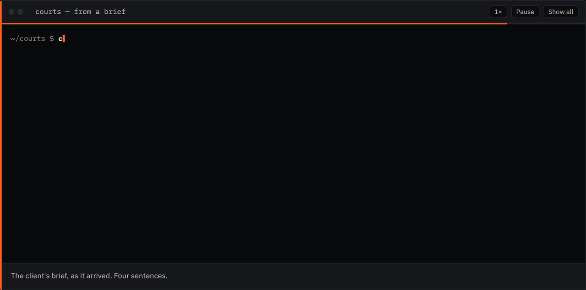
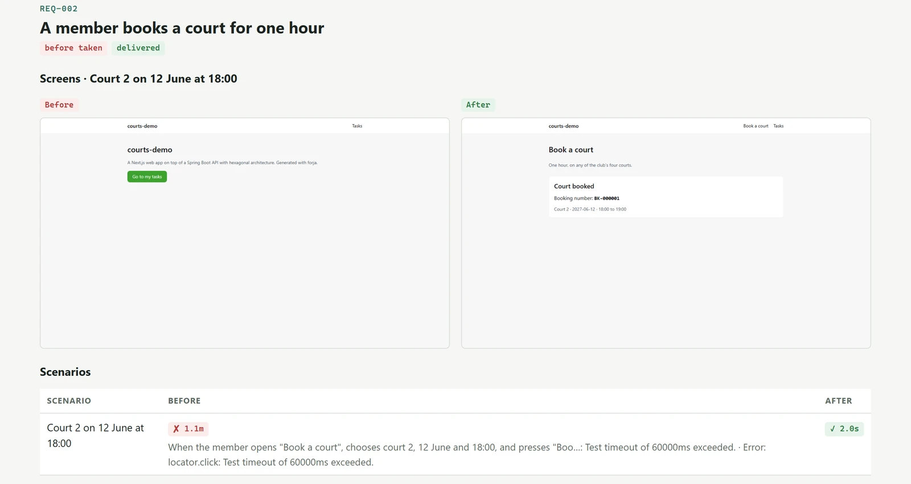
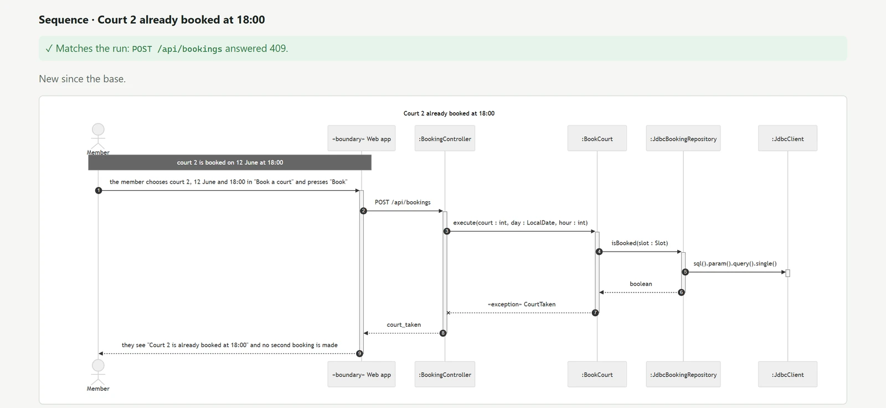

<div align="center">

# ⬡ Specgate

**Specs as executable contracts — requirements, scenarios and traceability that CI enforces.**

[](https://github.com/rsaglobaltech/specgate/actions/workflows/ci.yml)
[](https://www.npmjs.com/package/@rsaglobaltech/specgate)
[](https://github.com/rsaglobaltech/specgate/pkgs/container/specgate)
[](https://rsaglobaltech.github.io/specgate/)
[](#-license)



</div>

**The problem:** what the client asked for, what was built and what was tested drift apart — fastest
when an AI agent writes the code. Specgate ties the three together and fails the build when they disagree.

- **A gate in CI** — `specgate check` fails a pull request when a delivered requirement has no scenario, no test that names it, or a red suite.
- **From the client's brief** — requirements and Gherkin scenarios drafted from the brief; a value it never gave becomes a question, not a guess.
- **Evidence before and after** — each requirement's run before its code and after it: screenshots, why it was red, the calls to the service, the code drawn as UML and checked against the run.
- **Guardrails for coding agents** — test first, approved scope, sealed approvals: a person approves, the agent delivers. Claude Code, Codex and OpenCode.
- **Traceability for free** — the matrix is generated from the tests that name each requirement.

<p align="center"> </p>

Requirements live in the repository as numbered `REQ-NNN` with Gherkin scenarios, next to the code;
a test that mentions a requirement's id (`REQ-007`) is the link.

## ⚡ Install

You need **Node.js 22 or later**; 24 is the one to use (the current LTS). On 22, take 22.23.4 or later: it carries the October 2026 security fixes.

```bash
npm install --save-dev @rsaglobaltech/specgate   # in a project with a package.json
npx specgate --help
```

Without installing it (an empty folder, a Java or Python project), prefix each
command with `npx @rsaglobaltech/specgate@latest` instead of `npx specgate`.
With Docker and no Node.js: `docker run --rm -v "$PWD:/workspace" ghcr.io/rsaglobaltech/specgate check`.

Coming from 0.x? `specgate migrate 1.0` — [migrating](docs/migrating-to-1.0.md) · [what 1.x promises](docs/compatibility.md).

Then run `init` once:

- **In a repository that has code** (`package.json`, `pom.xml`, `go.mod`, …),
  `specgate init` adopts it in place: it adds `spec.md`, `features/` and
  `docs/specs/`, and changes no source file.
- **In an empty folder**, `npx @rsaglobaltech/specgate@latest init` asks for the name, stack and test
  toolchain and scaffolds a specification project in a new sub-folder (`--yes` takes the defaults).

Step by step, with every output shown: [Getting started](docs/getting-started.md).

## 🔁 The lifecycle — four verbs

```bash
specgate propose add-pdf-invoices   # open a change: a proposal, a delta to write, REQ ids reserved
# write REQ-007 and its scenario in the delta, a test that mentions REQ-007, then the code
specgate apply REQ-007              # refused until a test names it and the gate passes; then Implemented
specgate status                     # what is left, and the next command to run
specgate archive add-pdf-invoices   # once every requirement in it is Implemented
```

`specgate check` runs the same gate before a pull request and in CI;
`specgate ci init` writes the CI job for GitHub, GitLab, Azure or Jenkins.
You archive a change on its branch, before the pull request, so the spec and
the code reach review together.

## 📥 Where work comes from

Every piece of work enters the same lifecycle. Pick the entry that matches what
you have:

| You have | Run | Guide |
| --- | --- | --- |
| One behaviour to add or change | `specgate propose <change-id>` | [Propose one change](docs/start/existing-2-specify.md) |
| A client brief, or a plan for a new product | `specgate propose --from-brief` | [From a client brief](docs/from-a-brief.md) |
| A Jira story with acceptance criteria | `specgate propose --from-ticket <KEY>` | [From a Jira ticket](docs/from-a-ticket.md) |
| A system that already runs, never specified | `specgate reverse <module>` | [Specify a system that already runs](docs/reverse.md) |

## 🛠️ What it does

- **A gate that does not lie.** `check` fails when a delivered requirement has
  no scenario, no test that names it, or your suite fails. A `Draft` owes
  nothing yet, so the gate is green on day one. → [Validating](docs/validating.md)
- **Drafts held to their source.** A draft from a brief or a ticket lists every
  value the source never gave; what only the client can answer becomes a
  question. The brief's quality requirements, under ISO/IEC 25010, become
  non-functional requirements with a number a test checks.
  → [From a client brief](docs/from-a-brief.md)
- **Your agent works the same loop.** Slash commands, Agent Skills and an MCP
  server for Claude Code, Cursor, Copilot and others; `specgate harness run`
  delivers each requirement unattended, in its own worktree, and keeps only
  what passes. → [Agent tools](docs/agents.md) · [The harness](docs/harness.md)
- **Code that already runs.** `specgate reverse` drafts requirements from an
  existing module; `check --baseline` turns the gate on without a red build.
  → [Reverse](docs/reverse.md)
- **For the whole team.** A change in three layers — Discover, Design, Tasks —
  each approved by whoever holds its role; ADRs, a glossary and numbered rules; a
  review page, the studio as an app, release notes and an acceptance a person
  signs. → [The method](docs/methodology.md) · [Studio](docs/studio.md)
- **Several repositories, one product.** A workspace splits a story across
  repositories, checks the contracts between them and builds them in order.
  → [Workspace](docs/workspace.md)
- **More in the docs:** [quality checks](docs/quality.md) in Docker,
  [domain packs](docs/domain-packs.md), [OpenSpec](docs/openspec.md).

## 🆚 How it compares

Specgate does each of the things below. What the closest alternatives cover:

| Capability                    | [OpenSpec](https://github.com/Fission-AI/OpenSpec) | [spec-kit](https://github.com/github/spec-kit) | [Cursor rules](https://docs.cursor.com/context/rules-for-ai) |
| ----------------------------- | :------------------------------------------------: | :--------------------------------------------: | :----------------------------------------------------------: |
| Change lifecycle              |                         ✅                         |                       ❌                       |                              ❌                              |
| Traceability matrix + CI gate |                         ❌                         |                       ⚠️                       |                              ❌                              |
| Draft checked against a brief |                         ❌                         |                       ⚠️                       |                              ❌                              |
| Work from Jira tickets        |                         ❌                         |                       ❌                       |                              ❌                              |
| Versioned domain packs        |                         ❌                         |                       ⚠️                       |                              ❌                              |
| Vendor-neutral                |                         ✅                         |                       ✅                       |                              ❌                              |

OpenSpec is the closest tool: if you want the change loop without an enforced
gate, it fits better. → [Full comparison](docs/comparisons.md)

## 📚 Documentation

- [Getting started](docs/getting-started.md) — install, pick your path, the four verbs
- [What to tell your agent](docs/agent-kickoff.md) — the prompt for Codex, OpenCode or Claude Code, or `specgate status --prompt`
- [From a Jira ticket](docs/from-a-ticket.md) · [From a client brief](docs/from-a-brief.md) · [From running code](docs/reverse.md)
- [What is new in 1.0](docs/whats-new-1.0.md) · [Migrating from 0.x](docs/migrating-to-1.0.md) · [Compatibility](docs/compatibility.md)
- [Concepts](docs/concepts.md) — the ideas and vocabulary behind every command
- [Commands](docs/commands.md) — every command and flag
- [FAQ](docs/faq.md) · [Troubleshooting](docs/troubleshooting.md) · [Docs site](https://rsaglobaltech.github.io/specgate/)

## 🧰 Companion tools

[Language server](packages/lsp-spec-driven) · [VS Code extension](packages/vscode-spec-driven) · [Maven](packages/maven-plugin) and
[Gradle](packages/gradle-plugin) plugins for builds without Node · Docker image `ghcr.io/rsaglobaltech/specgate`

## 🤝 Contributing

PRs welcome — see [CONTRIBUTING.md](CONTRIBUTING.md) · [MAINTAINERS.md](MAINTAINERS.md) ·
[SECURITY.md](SECURITY.md) for private reports.

## 📄 License

MIT © RSA Global Tech
