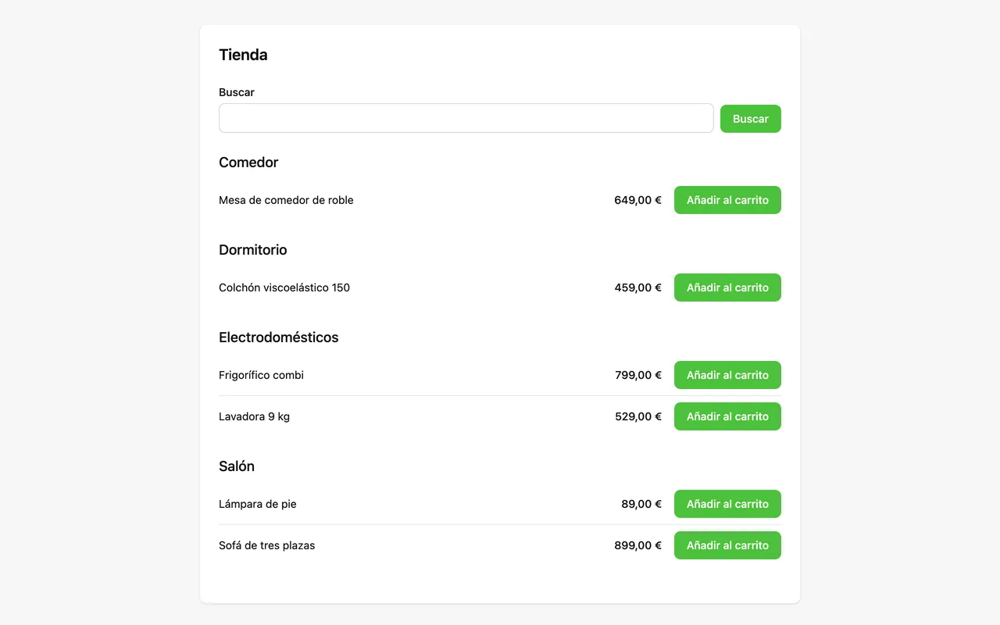
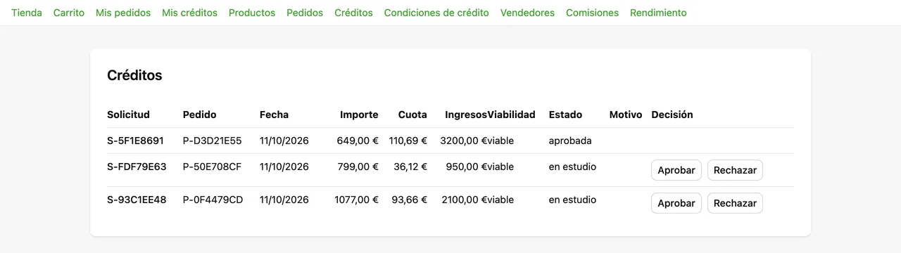

# Credit shop — an online store with credit and a sales network

<!-- csda:note -->
**A real client brief, built by an agent with Specgate.** The brief came from a real client; the product was built end to end by a coding agent (Claude) driving Specgate, with business decisions delegated to it and written down as assumptions. It is not a customer deployment, and the code repository is private.
<!-- csda:endnote -->

This is agent-driven adoption, not a customer story. It is the opposite of
[Bookings](bookings.md): a brief with almost nothing in it, where the draft
had to invent nearly every value and the checklist had to make that visible.

| | |
|---|---|
| **Brief** | Vague: five lines, no values, rules or screens |
| **Stack** | Next.js + a hexagonal TypeScript core (`packages/core`) |
| **Requirements** | 24 of 24 |
| **Tests** | 272 test cases in the repository |
| **Specgate** | 0.17.2 → 0.17.5 |

## The brief

One paragraph: an application that manages credit, online sales and a network
of sellers. A catalog and a cart, credit applications, commissions and
performance for the sellers. It should be "scalable, secure and easy to use".
Not one price, limit, rule or screen.

## How Specgate was used

<!-- csda:steps -->
### One draft per module

```bash
specgate change new draft-tienda --capability tienda --reserve <n>
specgate draft --check draft-tienda      # then draft-credito, draft-red
```

The draft rule D8 caps a draft at 25 requirements, so the MVP was cut into
three: store (9 requirements), credit (7), sales network (6).

### Turn every finding into an assumption or a question

D6 flagged 50, 36 and 23 invented values in the three drafts, covered in
the end by 6, 5 and 5 written assumptions. Two questions blocked a requirement:
who pays for shipping, and who finances the credit. Those requirements went
in as `Needs Clarification`.

### Archive and build

```bash
specgate change archive draft-tienda
specgate harness run
```

### Answer the questions as a change

The answers went in as a change named `respuestas`, with REQ-008 and REQ-016
MODIFIED. Then the harness built them.
<!-- csda:endsteps -->

The harness built 20 of 20 buildable requirements, 15 on the first attempt.
It refused the two blocked ones in about a second, without calling the agent:
"status is Needs Clarification — an agent asked to settle a disagreement will
settle it by guessing."

## What was built

| Module | Requirements | Notes |
|---|---|---|
| Store | 10 | Catalog, cart, orders, shipping; REQ-027 adds a menu per role |
| Credit | 7 | Application, pre-contract information, approval, online contract |
| Sales network | 6 | Sellers, referral links, commissions, settlement, performance |
| Adoption baseline | 1 | REQ-001 |

REQ-012 (information before credit) cites the Spanish consumer-credit law
with its source, and D5 checks that it does. The numbers were computed
before they were written into scenarios: 1,200 € over 12 months at 12 %
nominal gives a monthly payment of 106.62 €, an APR of 12.68 % and a total of
1,279.44 €.

The answers decided: shipping is 4.95 € below 50 €, and the store finances
the credit, with the contract accepted online. The product reached `v0.1.0`.





## What only running the product found

With every test green, **nobody could buy anything.**

- **The store had no "Add to cart" button.** REQ-005 had an API scenario for
  adding and a screen scenario for changing the quantity. The agent built
  exactly that.
- **No screen had a menu.** The administrator's panel said "Hello" and
  nothing else.
- Prices with a decimal comma could not be typed into a number field in an
  English-language browser.

It is the same pattern as the photos in Bookings: an action with an API
scenario and no screen scenario is not built on screen. D3 does not see it,
because the requirement does have *a* screen scenario.

A follow-up change, `tienda-2`, MODIFIED REQ-005 and added REQ-027. The
second smoke test walked the whole journey without touching code: a customer
arrives through a seller's link, buys, asks for credit, the administrator
approves, the customer signs, the order is delivered, the seller's
commission is settled, and the performance view shows it.

## What Specgate got wrong, and what changed

| Finding | Fixed in |
|---|---|
| #59 — `validate --strict` failed on the two `Needs Clarification` requirements: the gate punished the draft for asking instead of guessing | 0.17.3 |
| #60 — `init` proposed three requirements on a fresh skeleton (third time across pilots) | 0.17.4 |
| #65 — the harness lost attempts on REQ-011, REQ-017 and REQ-018 because `done` reordered the trace; twice the agent then tried to edit the matrix by hand, and write-scope stopped it | 0.17.5 |
| #66 — a hung agent ran 53 minutes against a 20-minute limit | 0.17.5 |
| #76 — an action on an id the actor has no way to get (seen here and in Bookings first) | 0.17.9 (D12) |

With 0.17.5, the two `tienda-2` requirements passed on the first attempt
with no write-scope losses.

## Still open

- **An API action with no screen scenario (D11).** A rule is reserved, not
  built: matching each API scenario to its screen scenario is not mechanical,
  and a rule by count gave false positives on this pilot's drafts and
  Bookings' (#83). Running the product stays the safety net.
- **Minor noise.** D6 reads the "500" in a product URL as a value.
- **No question waits for an answer.** Both were answered and built.

[← Bookings](bookings.md) · [FinCore →](fincore.md)
