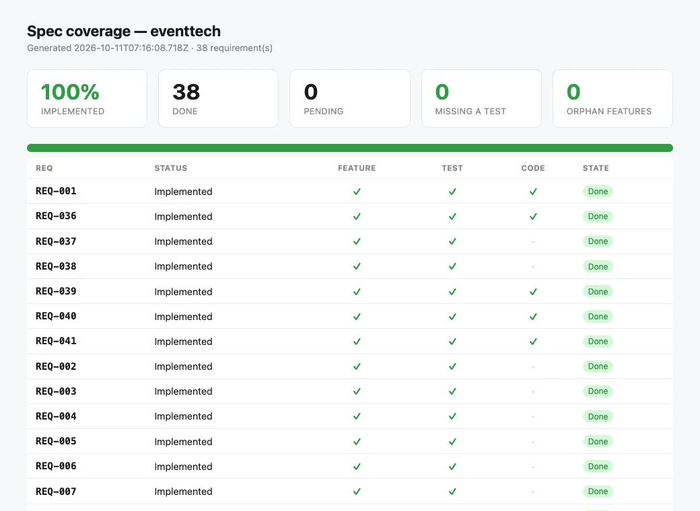

# EventTech — corporate event operations on Quarkus

<!-- csda:note -->
**A real client brief, built by an agent with Specgate.** The brief came from a real client; the product was built end to end by a coding agent (Claude) driving Specgate, with business decisions delegated to it and written down as assumptions. It is not a customer deployment, and the code repository is private.
<!-- csda:endnote -->

This is agent-driven adoption, not a customer story. It was the first pilot
on Quarkus, and the first to use rule D12 the day it shipped.

| | |
|---|---|
| **Brief** | Architecture-heavy: event sourcing, CQRS, change data capture |
| **Stack** | Quarkus 3.40 · Java 21 · Maven · PostgreSQL (Dev Services) · WebSocket · ArchUnit |
| **Requirements** | 38 of 38 |
| **Tests** | 71 |
| **Specgate** | 0.17.9 |

## The brief

Operations for corporate events: parallel sessions, speakers, registration,
catering by dietary restriction, transport, hotels, badges, live room
occupancy and reports. Like FinCore, it came with a lot of architecture —
EventStoreDB, CQRS, Debezium.

The infrastructure was set aside, but what it promises was kept as
functional requirements: rebuild the event as it was at any time ("the
agenda on any date", "when did the room fill up?"), live updates, and
reports.

## How Specgate was used

<!-- csda:steps -->
### Adopt once

```bash
specgate init --no-capabilities
specgate config set test_cmd "./mvnw -q -B verify"
specgate ci init --provider github       # setup-java 21, Maven cache, specgate check
```

### One draft per module

```bash
specgate change new draft-eventos --capability eventos --reserve <n>
specgate draft --check draft-eventos
```

D12 found a real gap in the first draft: the organizer could not see the
sessions of an event still in draft. From then on, every draft said where
each id comes from from the start.

### Archive, test, close

```bash
specgate change archive draft-eventos
specgate done REQ-047
specgate check
```
<!-- csda:endsteps -->

Five drafts, one per module, and one follow-up change (`informes-2`).
`@QuarkusTest` starts the whole application, so the lesson from FinCore —
an app that does not start while every test is green — came built in: a
startup test was there from the first commit.

## What was built

| Module | Requirements | Notes |
|---|---|---|
| Events | 11 | Event sourcing on Postgres: an insert-only JSONB fact table; the agenda at any date |
| Registration | 8 + REQ-008 MODIFIED | Capacity and seats decided in one aggregate; concurrency tested; waiting list |
| Logistics | 8 | Catering adjustments computed as current order minus sent, nothing stored |
| Access | 6 | HMAC badges; live occupancy over WebSocket, sent only after commit |
| Reports | 4 + REQ-047 MODIFIED | Everything rebuilt from the facts |
| Adoption baseline | 1 | REQ-001 |

Two requirements were MODIFIED. Archiving regenerated each feature file and
sent the requirement back to Draft until its new scenario passed.




*`specgate report` for this project, generated from its matrix at the end of the pilot.*

## What only running the product found

| Gap | How it was closed |
|---|---|
| A badly written date returned 400 with no body | A test and an error mapping for the JSON parser |
| A session could be moved to a smaller room | REQ-008 MODIFIED |
| Nobody could see a session's free seats | REQ-041 added |
| Entries without a booking were invisible; no-shows counted for sessions still to come | REQ-047 MODIFIED (`informes-2`) |

The rule from the three pilots before holds: the gate verifies what the
specification says; using the application finds what it does not say.

## What Specgate got wrong, and what changed

| Finding | Fixed in |
|---|---|
| #80 — D12 flagged actions whose id the actor gets through a **nested** list (`GET /api/eventos/{id}/sesiones` for `POST /api/sesiones/{id}/…`); three drafts had to declare it as an assumption | 0.17.10 |
| #81 — a MODIFIED requirement went through D12 again without seeing the assumption from its archived draft | 0.17.10 |

Quarkus needed no adaptation: Specgate detected it and `./mvnw`, the
generated CI installed Java 21, and Dev Services ran in GitHub Actions.

## Still open

- **No question waits for an answer.** All 38 requirements are implemented.
- **The infrastructure in the brief** — EventStoreDB, change data capture to
  marketing and CRM tools, video conferencing, payments, real NFC readers —
  is out of scope. Each has a port ready for it.

[← FinCore](fincore.md) · [HealthTech →](healthtech.md)
