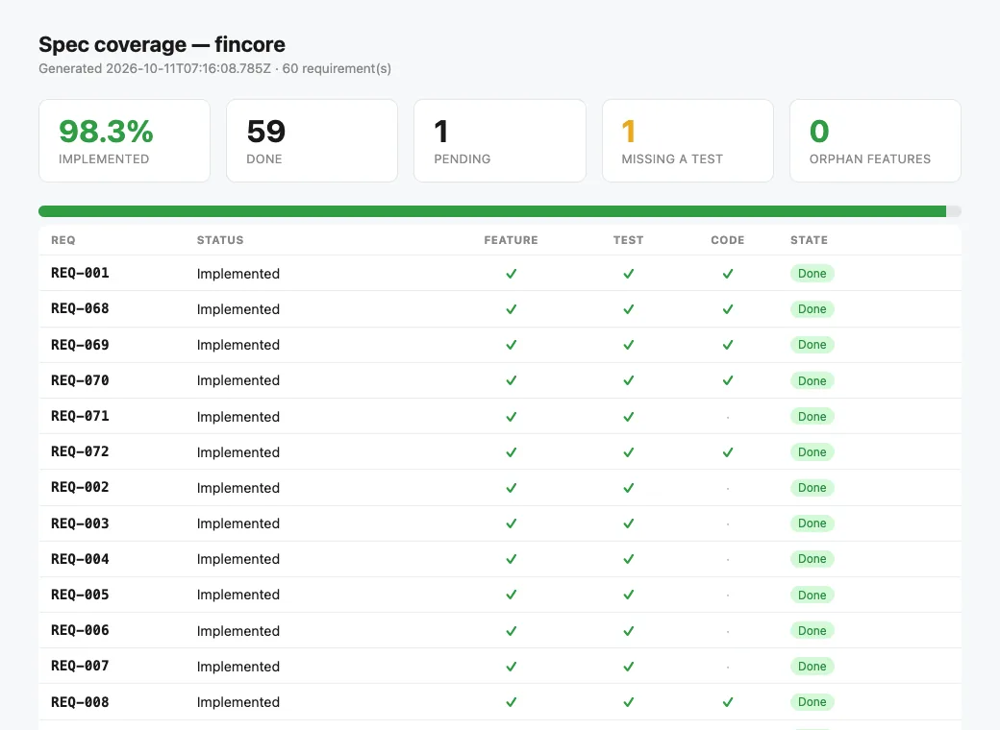

# FinCore — core banking on Spring Boot

<!-- specgate:note -->
**A real client brief, built by an agent with Specgate.** The brief came from a real client; the product was built end to end by a coding agent (Claude) driving Specgate, with business decisions delegated to it and written down as assumptions. It is not a customer deployment, and the code repository is private.
<!-- specgate:endnote -->

This is agent-driven adoption, not a customer story. It was the first pilot
outside Node, and it was kept as a step-by-step log so the tool could be
learned from it.

| | |
|---|---|
| **Brief** | Architecture-heavy: much *how*, one line of *what* per module |
| **Stack** | Spring Boot 3.3 · Java 21 · Maven · PostgreSQL (Testcontainers) · Flyway · ArchUnit |
| **Requirements** | 59 of 60 — one waits for a legal answer |
| **Tests** | 112 |
| **Specgate** | 0.17.7 → 0.17.8 |

## The brief

A digital bank: accounts, payments, cards, identity, fraud, audit and
notifications. Most of the brief was architecture — DDD microservices, Kafka,
Redis, Keycloak, Kubernetes, CQRS, sagas, 10,000 requests per second and
99.99 % availability — with one line of what each module should do.

A technical plan is not a specification. Run through `draft --check` as it
was, it would have returned almost nothing but questions. So the
architecture was set aside on purpose: one application, one hexagonal package
per module, API only.

## How Specgate was used

<!-- specgate:note -->
Recorded with Specgate 0.16–0.18. Today the same steps are: propose → build and apply each requirement → archive.
<!-- specgate:endnote -->

<!-- specgate:steps -->
### Adopt once

```bash
specgate init --no-capabilities
specgate config set test_cmd "mvn -q -B verify"
specgate ci init --provider github
```

### One draft per module

```bash
specgate change new draft-cuentas --capability cuentas --reserve <n>
specgate draft --check draft-cuentas     # until it passes
```

Values computed before they were written: an IBAN, a Luhn check digit, an
ID number. One IBAN written by hand cost a red cycle.

### Assumptions and questions

Every invented value went into `assumptions.md`, marked "to validate". Every
legal or business decision the brief did not make went into `questions.md`,
with a proposed answer. Together they are the agenda for the client meeting.

### Archive, write the test, close

```bash
specgate change archive draft-cuentas
specgate done REQ-002                    # refuses unless a test names it and the suite is green
specgate check                           # before each push; CI runs the same
```
<!-- specgate:endsteps -->

Seven drafts and two follow-up changes (`cuentas-2`, `pagos-2`). No harness
here: each requirement was implemented, tested and closed with `done`.

## What was built

| Module | Requirements | Notes |
|---|---|---|
| Accounts (+ `cuentas-2`) | 11 | IBAN computed per ISO 13616; double-entry ledger with an immutability trigger |
| Payments (+ `pagos-2`) | 12 | SEPA with automatic reversal (the brief's "saga"), `FOR UPDATE` concurrency, idempotency |
| Cards | 7 | Luhn, PAN encrypted with AES-256-GCM, derived CVV (PCI DSS 3.3–3.5) |
| Identity | 9 + 1 waiting | SMS MFA, sessions; REQ-055 waits for an answer |
| Fraud | 6 + REQ-038 MODIFIED | Events after commit instead of Kafka |
| Audit | 5 | Hash-chained log with SHA-256; trial balance |
| Notifications | 8 | Queue with retries; the one-time code is never stored |
| Adoption baseline | 1 | REQ-001 |

CI on GitHub runs `specgate check`: the specification and the tests.




*`specgate report` for this project, generated from its matrix at the end of the pilot.*

## What only running the product found

1. **Actions on things nobody could find.** An operator could settle a SEPA
   transfer by id, with no list of pending ones. A customer could open an
   account and had no way to see its IBAN again. Third pilot in a row with
   this pattern; it became rule D12 (#76).
2. **A requirement wider than its scenario.** REQ-031 says every error
   answers `{"error": …}`. It had one scenario, and Spring's own 404 and 405
   broke the rule while `done` was green.
3. **The application did not start, with the gate green** (#78). Every test
   replaced SMS and the clock with doubles, so none started the real
   context; one missing bean went unseen. A startup test with no doubles now
   runs in the suite.

## What Specgate got wrong, and what changed

| Finding | Fixed in |
|---|---|
| #72 — **serious.** `done REQ-055` marked Implemented a requirement in `Needs Clarification`, with no test naming it and no code | 0.17.8 |
| #73 — `status` listed a blocked requirement as work to start | 0.17.8 (a "Waiting for an answer" group) |
| #74 — D6 did not read id ranges (`REQ-004..REQ-010`) in assumptions: 25 findings | 0.17.8 |
| #76 — an action on an id the actor cannot obtain | 0.17.9 (D12) |
| #75 — D6 rejected values given by the norm the requirement cites | 0.17.10 |
| #77 — closing 8 requirements meant 8 full test runs | 0.17.10 (`done` takes several ids) |
| #78 — no startup test without doubles in Spring projects | 0.17.10 (`init` suggests it; the harness prompt requires it) |
| #79 — a trace line under the title was not read (found fixing #72) | not reproduced in 0.17.10; `validate` now warns about a trace no requirement owns |

Just before this pilot, a tutorial rehearsal and a Spring Boot probe found
#67–#71: a template obligation closed by `done`, no way to set the test
command without the harness, the Maven parent taken as the project name,
**a CI workflow that never ran the tests**, and `harness init` refusing after
`config set`. They were fixed in 0.17.6 and 0.17.7, and each fix was verified
on FinCore.

What worked unchanged on the JVM: Maven and Gradle detection, linking tests
by `@DisplayName("REQ-002 SCN-002: …")`, `done` refusing on red, Spanish
scenarios, and a MODIFIED requirement regenerating its feature file and
going back to Draft.

## Still open

- **REQ-055: GDPR erasure against the 10-year retention required by
  anti-money-laundering law.** Which data is erased, when, and who decides is
  a legal question for the client, not for the developer. Two options are
  written down; neither is chosen. The requirement stays in `Needs
  Clarification`, `status` lists it under "Waiting for an answer", and `done`
  refuses it. That is the intended outcome.
- **Every assumption marked "to validate"** waits for the client meeting.
- **The architecture in the brief** — microservices, Kafka, Redis, Keycloak,
  Kubernetes, the throughput and availability targets — is out of scope.
  The ports are where it would plug in.

[← Credit shop](credit-shop.md) · [EventTech →](eventtech.md)
