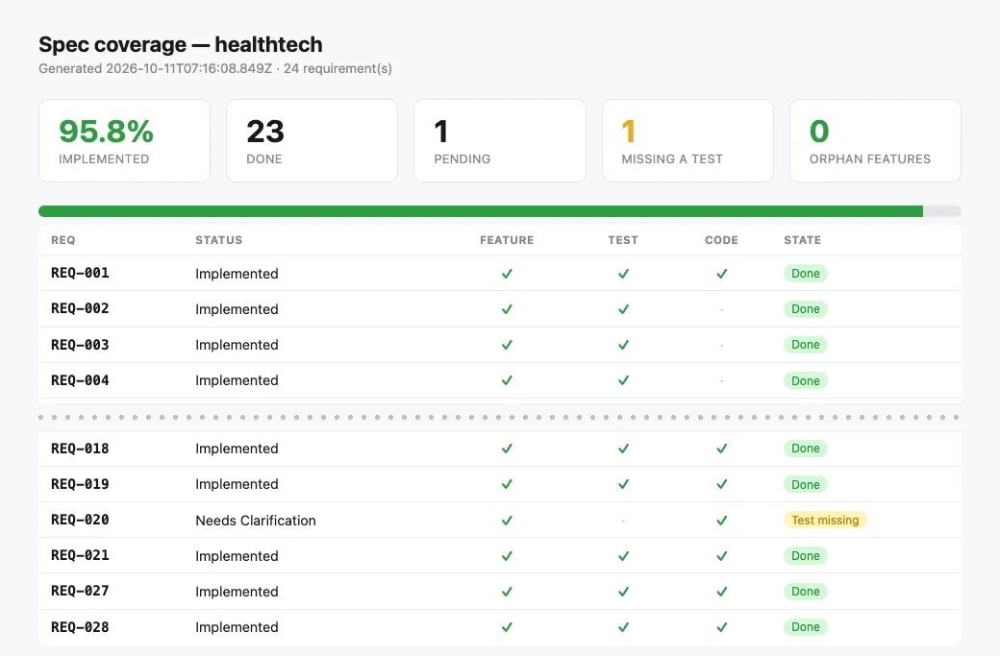

# HealthTech — clinical case records on Quarkus

<!-- specgate:note -->
**A real client brief, built by an agent with Specgate.** The brief came from a real client; the product was built end to end by a coding agent (Claude) driving Specgate, with business decisions delegated to it and written down as assumptions. It is not a customer deployment, and the code repository is private.
<!-- specgate:endnote -->

This is agent-driven adoption, not a customer story. It was the first pilot in
a regulated domain, and its limits were agreed before any code: no invented
clinical rules, fictitious data only, and every legal or medical decision
left to the client.

| | |
|---|---|
| **Brief** | Regulated (health), with heavy architecture |
| **Stack** | Quarkus 3.40 · Java 21 · Maven · PostgreSQL · ArchUnit |
| **Requirements** | 23 of 24 — one waits for an answer, on purpose |
| **Tests** | 35 |
| **Specgate** | 0.17.9 |

## The brief

Specialists and private clinics keep basic records that do not connect to
laboratories, imaging or insurers. The brief asked for a platform built
around the clinical case rather than the patient: studies, lab results,
prescriptions, similar cases, and the data exposed as FHIR R4. It came with
EventStoreDB, Debezium, Elasticsearch and SMART on FHIR. As in FinCore and EventTech, the
infrastructure was set aside and its promises kept: rebuild a case, find
similar ones, read in FHIR R4.

The actors are the doctor, the laboratory that sends results, and the person
responsible for data protection, who reviews who read what.

## How Specgate was used

<!-- specgate:steps -->
### Adopt once

```bash
specgate init --no-capabilities          # Java 21, Quarkus, Maven · ./mvnw -B test
specgate config set test_cmd "./mvnw -q -B verify"
specgate done REQ-001
specgate ci init --provider github
```

### Draft, with the domain's limits

```bash
specgate change new draft-casos --capability casos --reserve <n>
specgate draft --check draft-casos
```

D5 made each cited standard name its source (ICD-10, FHIR R4). D6 made every
example value an assumption, and each `assumptions.md` says "fictitious, no
medical value". D12 flagged nothing: the ids' sources were written from the
start, a lesson from EventTech.

### Put every clinical and legal decision in `questions.md`

Drug interactions, record retention, using other patients' data, electronic
prescriptions, whether the product is a medical device. Each question names
the requirement it blocks.

### Archive, test, close

```bash
specgate change archive draft-casos
specgate done REQ-027
specgate check
```
<!-- specgate:endsteps -->

Three drafts and one follow-up change (`privacidad-2`).

## What was built

| Module | Requirements | Notes |
|---|---|---|
| Cases | 10 of 10 | Facts signed by author, corrections that never delete, the case as of any date |
| Studies | 4 of 4 | Simulated insurance coverage, lab results, results to review |
| Prescription | 3 of 4 | Recorded allergies, suspension; **REQ-020 (interactions) waits** |
| Consultation | 3 of 3 | Anonymised similar cases, read-only FHIR R4 |
| Privacy | 2 of 2 | Immutable access log; REQ-027 MODIFIED |
| Adoption baseline | 1 | REQ-001 |

The rules that were built are not clinical knowledge. They compare recorded
data (allergies), use what the lab flags (out of range), or check a format
(an ICD-10 code).




*`specgate report` for this project, generated from its matrix at the end of the pilot.*

## What only running the product found

- **Two reads left no trace.** Patient search — which returns allergies —
  and the lab's list did not appear in the access log. Fixed by REQ-027
  MODIFIED (`privacidad-2`).
- **A new question.** Should the record show an allergy alert that made the
  doctor change course? It is not built without an answer.

## What Specgate got wrong, and what changed

| Finding | Fixed in |
|---|---|
| #82 — D7 treated "this will be decided with the client" as an answer, so the requirement stopped waiting although nobody had decided anything | 0.17.10 ("TBD" or "se decidirá" no longer counts as an answer) |

`Needs Clarification` worked as a barrier. Since 0.17.8 (the fix for #72,
found in FinCore), `status` shows a blocked requirement under "Waiting for an
answer" and `done` refuses to close it.

## Still open

- **REQ-020: drug-interaction alerts.** This is exactly what an agent could
  fill in with an invented table. It waits on one question: which licensed,
  maintained interaction database to use, and who is responsible for its
  content — a system that warns of interactions may count as a medical
  device under EU Regulation 2017/745. Until the client answers, REQ-020 is
  not built, and the gate keeps it visible. That is the intended outcome.
- **Recording an alert the doctor acted on** — the question the running
  product raised.
- **The other legal questions** — retention, use of other patients' data,
  electronic prescriptions — wait for the client meeting. Where the pilot
  needed something, it used a simulated issuer or insurer, written down as
  a proposal to validate.

[← EventTech](eventtech.md) · [All projects](index.md)
