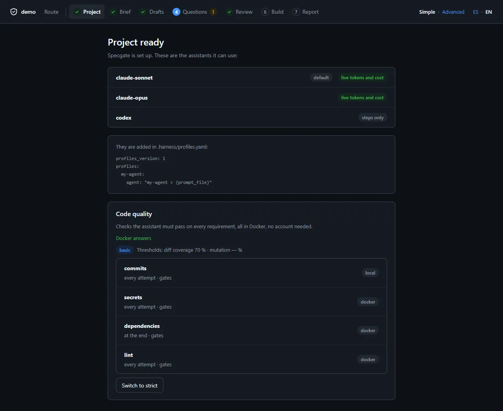

<!-- specgate:allow-placeholders -->

# Quality and security checks

The gate proves a requirement is specified, linked and tested. **Quality
checks** prove more: that the tests run the code the change added, that they
would notice a bug in it, that it adds no vulnerability, leaked secret or
architecture violation, and that its commits say what they do. Each check is a
tool your team already trusts — JaCoCo, PIT, SpotBugs, Semgrep, gitleaks,
SonarQube — run by Specgate in its container, judged so that **only what a
change adds can fail it**. At the end of this page you can turn them on for a
Java or Node project, take a baseline, and read a failure.

**You need:** a project where `specgate init` or `specgate adopt` has run, git,
and Docker (Docker Desktop on Windows and macOS). Nothing else: every tool runs
in its own image, and none needs an account. The decision is
[ADR-0040](specs/adr/0040-quality-and-security-in-the-gate.md).

## Turn them on

```bash
specgate quality init --level basic      # or --level strict
specgate quality doctor --pull           # how each check runs here; fetch the images
specgate quality baseline                # today's findings are debt, not failures
git add harness.config.yaml .specgate/quality-baseline.json .gitignore
git commit -m "chore: quality checks"
```

`quality init` reads the build files — `pom.xml`, `build.gradle`,
`package.json` — and writes the checks of the level into
`harness.config.yaml`, every other line kept. In a monorepo it reads each
app folder too — one level down, or in `apps/`, `packages/` and `services/` —
when the root has no build file of that stack: forja's `apps/api/pom.xml` gets
the Maven checks, run as `cd apps/api && mvn …`. A check whose tool your build
lacks is written commented, with what to add (PIT needs its JUnit 5 plugin in
the pom, Vitest coverage its provider). The studio's new-project step asks for
the level, and its project page turns it on or up:



## The two levels

| Check | What it runs | basic | strict |
| --- | --- | --- | --- |
| `commits` | Conventional Commits 1.0.0, natively | every attempt | every attempt |
| `secrets` | gitleaks | every attempt | every attempt |
| `dependencies` | osv-scanner on the lockfile; for Maven, on the bill of materials `sbom` writes | at the end | every attempt |
| `coverage` | JaCoCo / Vitest / Jest, then Specgate measures the changed lines | every attempt, 70 % | every attempt, 85 % |
| `types`, `lint` | `tsc --noEmit`, ESLint (Node) | every attempt | every attempt |
| `spotbugs` | SpotBugs (Java) | at the end | every attempt |
| `pmd` | PMD (Java) | — | every attempt |
| `semgrep` | Semgrep's Java or TypeScript/React rules | — | at the end |
| `mutation` | PIT (Java) or Stryker (Node), then Specgate scores the changed lines | — | at the end, 70 % |
| `review` | a second agent reads the change against the requirement | — | at the end, advises |
| `sonar` | SonarQube Community, local | — | commented: about 2 GB |

`diff_coverage:` and `mutation_score:` in `harness.config.yaml` override the
level's thresholds.

## Where they run

| Moment | attempt | end | ci |
| --- | :-: | :-: | :-: |
| Each harness attempt, after the tests pass | yes | yes, once the attempt checks pass | |
| `specgate check` | yes | yes | |
| `specgate check --ci` | yes | yes | yes |
| `specgate quality run [--stage attempt\|end\|ci]` | as asked | as asked | as asked |

In the harness a failing check fails the attempt at `quality check: <name>`,
and what it found — the new findings, the lines no test ran, the mutants that
survived — goes into the next attempt's prompt with a hint to fix, not
silence. A check that cannot run here (Docker stopped, a token missing) is
reported and skipped; under `--ci` it fails, because CI should have
everything.

## Only what a change adds

A tool run on an existing codebase reports its whole history. Specgate judges
a check that writes SARIF by its **findings**, not its exit code:

- A finding in `.specgate/quality-baseline.json` is debt the team already
  knows; it never fails the gate. `specgate quality baseline` writes the file;
  `--accept <check>` re-takes one check.
- A finding is recognised by a fingerprint that survives the code moving: the
  tool's own when it writes one, else the rule, the file and the text of the
  flagged line with its neighbours.
- With `scope: diff` (the default) only findings in files the change touched
  count; `scope: all` for a project-wide check such as dependencies.
- Outside a git repository nothing is known to have changed, so every finding
  not in the baseline counts.
- A finding in a file git ignores — a development `.env.local` — is left out:
  it is never part of a change or of the repository.

A failure names each new finding as `path:line [rule] message`. Commit the
baseline; it only shrinks unless someone runs `baseline --accept` on purpose.

## The two measures Specgate computes

Neither tool computes these per change, so Specgate does, from the reports the
tools already write:

- **Diff coverage** — of the executable lines added or changed since the base
  branch (committed or not, a new file counting whole), the share a test ran.
  Read from JaCoCo XML, LCOV or Cobertura. Below the threshold it names every
  changed line no test runs. A change with no executable line passes.
- **Mutation score** — of the mutants on those lines, the share a test killed.
  Read from PIT's `mutations.xml` or Stryker's `mutation.json`; survivors are
  named as `path:line mutator`. PIT is pointed at the changed classes only, so
  it stays fast.

## The `checks:` reference

```yaml
quality: strict
diff_coverage: 85
mutation_score: 70
commit_types: [wip]          # Conventional Commits types beyond the defaults
checks:
  - name: spotbugs
    run: "mvn -B -q compile com.github.spotbugs:spotbugs-maven-plugin:4.8.6.6:spotbugs -Dspotbugs.sarifOutput=true"
    when: attempt            # attempt | end | ci
    gate: true               # false: reported, never fails
    runner: docker           # docker | local | auto
    image: maven:3.9-eclipse-temurin-21
    volumes: [specgate-m2:/root/.m2]
    sarif: target/spotbugsSarif.json
    timeout: 900
```

| Key | Meaning |
| --- | --- |
| `run` | The command; or `builtin:commits`, `builtin:sonar`, `builtin:review`, `builtin:adversary` |
| `report` | `jacoco:`, `lcov:`, `cobertura:`, `pit:` or `stryker:` and a path — a measure Specgate takes |
| `sarif` | The SARIF the tool writes, judged against the baseline |
| `scope` | `diff` (default) or `all` |
| `env` | Environment variable **names** forwarded to the container; a value is refused |
| `volumes` | Named volumes for caches, `name:/path`; a host folder is refused |
| `network` | `false` runs the container with no network |
| `profile` | For `review` and `adversary`: the profile whose agent runs it |
| `docker` | `true` gives the container the host's Docker, for tests that start containers (Testcontainers); the Maven and Gradle presets set it when the build declares Testcontainers |
| `needs` | An earlier check whose output this one reads (Maven's `dependencies` needs `sbom`); `quality baseline` runs it first |

Placeholders in `run`: `{req}`, `{base}`, `{changed_files}`,
`{changed_classes}` (Java, for PIT), `{changed_src}` (TypeScript, for Stryker)
and `{report_dir}`. `{changed_classes@apps/api}` and `{changed_src@apps/web}`
keep that folder's files only, relative to it.

## Docker

Every preset writes `runner: docker`: the build's own plugins run through the
project's Maven, Gradle or npm inside their image, the scanners in theirs. A
machine needs Docker and nothing else, and a laptop runs what CI runs.

- Docker must run **Linux containers**: the images are Linux images. Docker
  Desktop on Windows containers is reported as such, and the checks are
  skipped until it is switched.
- The project is mounted at `/src`; on Linux and macOS the files a container
  writes are handed back to you, never left to root.
- Dependency caches live in named volumes (`specgate-m2`, `specgate-gradle`,
  `specgate-npm`), so the second run does not download the world.
- Images are pinned; `specgate quality doctor --pull` fetches them ahead of a
  run, which is how CI should warm them.

## SonarQube, without an account

`run: builtin:sonar` starts SonarQube Community in a container named
`specgate-sonarqube`, on <http://127.0.0.1:9123> only, the first time it
runs. Specgate creates an analysis token once with the default login and keeps
it in `.specgate/sonar.local`, which it adds to `.gitignore`; it never changes
the password. Log in with `admin` / `admin` and change it. Once you have, give
Specgate a token you create there as `SONAR_TOKEN`. The issues come back as
SARIF, so the baseline judges them like any check's. It needs about 2 GB of
memory, which is why `strict` lists it commented.

## Conventional Commits

`builtin:commits` checks every commit since the base against
[Conventional Commits 1.0.0](https://www.conventionalcommits.org/en/v1.0.0/):
`type(scope)!: description`, a blank line before the body, `BREAKING CHANGE:`
in capitals. Merge commits are left out, and `fixup!`/`squash!` ones outside
CI. The harness asks its agent for `feat(REQ-007): …`, and the commits
Specgate writes follow the format.

## A second agent

`builtin:review` has an agent read the change against the requirement and its
scenarios and answer `VERDICT: PASS` or `FAIL` with its reasons;
`builtin:adversary` has one write a test that tries to break the change. Both
run inside the harness only, advise unless `gate: true`, and never touch the
implementer's work: the worktree is put back exactly as it was.

## Your architecture tool too

With `arch_sarif:` beside `arch_cmd:`, the architecture check is judged the
same way: `specgate quality baseline` records its findings as `arch`, and only
a violation the change adds fails ([ADR-0028](specs/adr/0028-architecture-conformance-is-part-of-the-gate.md)).

## Where the results show

- `specgate harness report` — the quality of what was delivered: diff
  coverage and mutation score, mean, and how often each check ran.
- The live view — each check is a step of the gate, with its measure.
- The studio — the project page lists the checks and how each runs here; the
  report carries each requirement's figures.

## When it goes wrong

| What you see | What to do |
| --- | --- |
| `Docker is not running here` | Start Docker Desktop, or the daemon. |
| `no report at …` | The tool did not write its report: is the plugin in the build (JaCoCo, Vitest's coverage provider)? |
| `no SARIF at …` | The tool failed before writing it; its output is above the line. |
| A check finds the same old issue on every change | Take the baseline: `specgate quality baseline --accept <check>`. |
| `SonarQube's default login no longer works` | Create a token at `/account/security` and set `SONAR_TOKEN`. |
| PIT is slow | It is scoped to the changed classes; give the check a larger `timeout`. |

## Next

- [Validating](validating.md) — everything else the gate checks.
- [The harness](harness.md) — where the checks feed the agent.
- [The studio](studio.md) — the same, without the commands.
