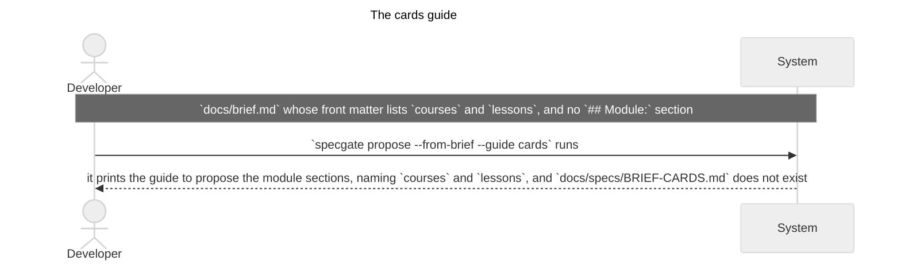
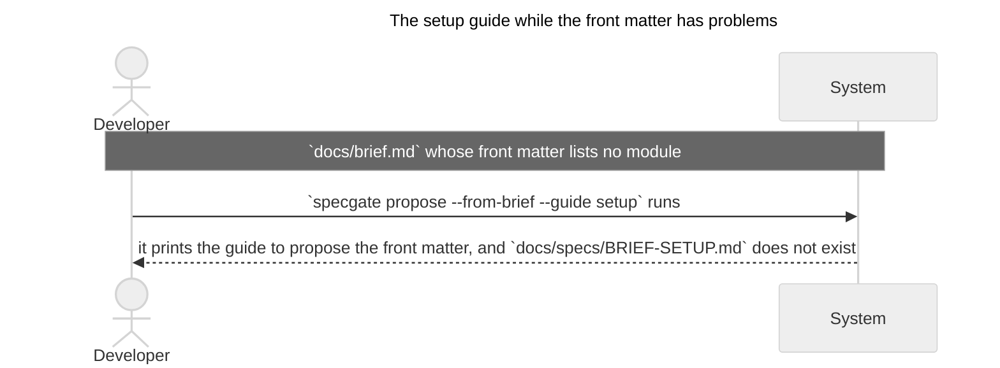
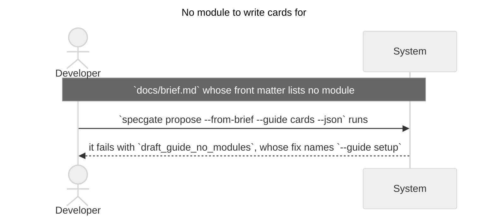
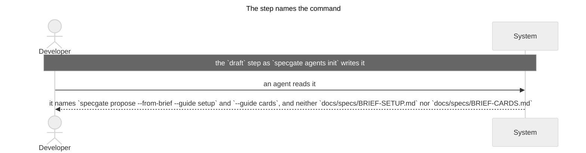
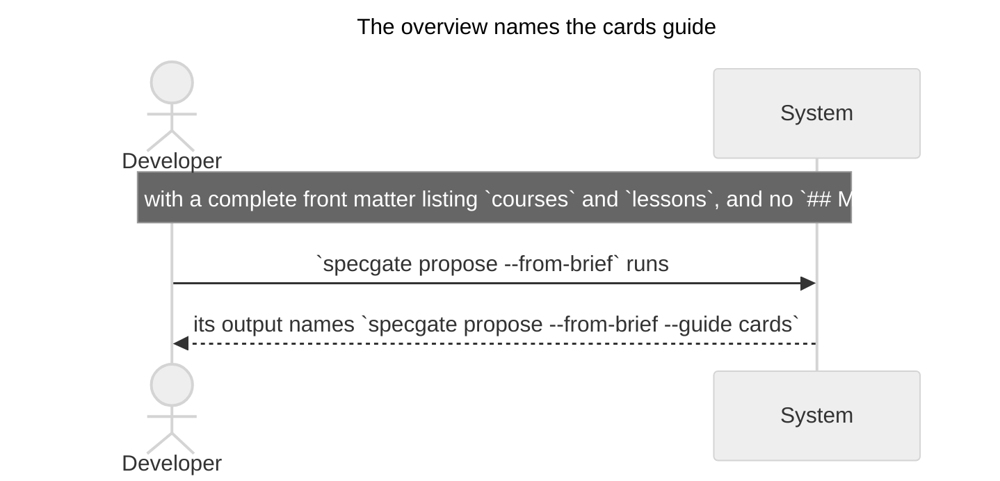

# Evidence — brief-guides

> Written by `specgate evidence brief-guides` (ADR-0047): each requirement before its code and after it.
> The screens are the last screenshot of each test; videos and traces stay in `.specgate/evidence/`, out of git.

## REQ-796 — The brief's guides are printed on request

- No before: `specgate evidence before REQ-796`
- No screenshots: `specgate doctor` says how to have the runner keep them

### The cards guide

· Drawn from the steps: no endpoint in the code answers them.

New since the base.

### The setup guide while the front matter has problems

· Drawn from the steps: no endpoint in the code answers them.

New since the base.

### No module to write cards for

· Drawn from the steps: no endpoint in the code answers them.

New since the base.

## REQ-797 — The draft skill sends the agent to a guide that exists

- No before: `specgate evidence before REQ-797`
- No screenshots: `specgate doctor` says how to have the runner keep them

### The step names the command

· Drawn from the steps: no endpoint in the code answers them.

New since the base.

### The overview names the cards guide

· Drawn from the steps: no endpoint in the code answers them.

New since the base.
