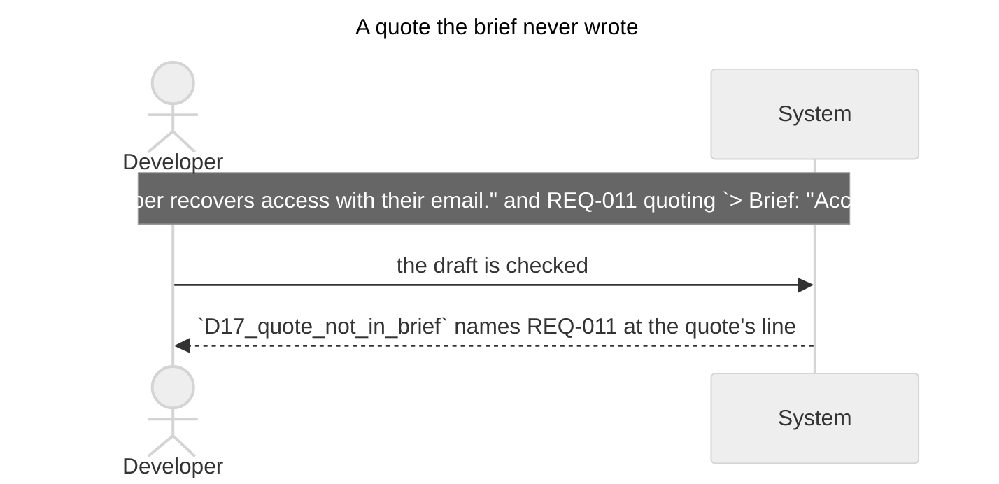
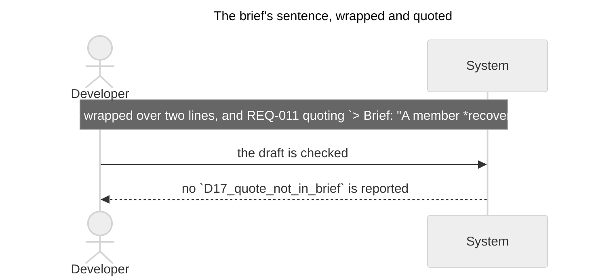
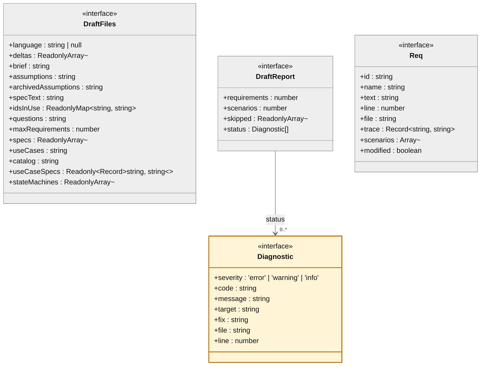
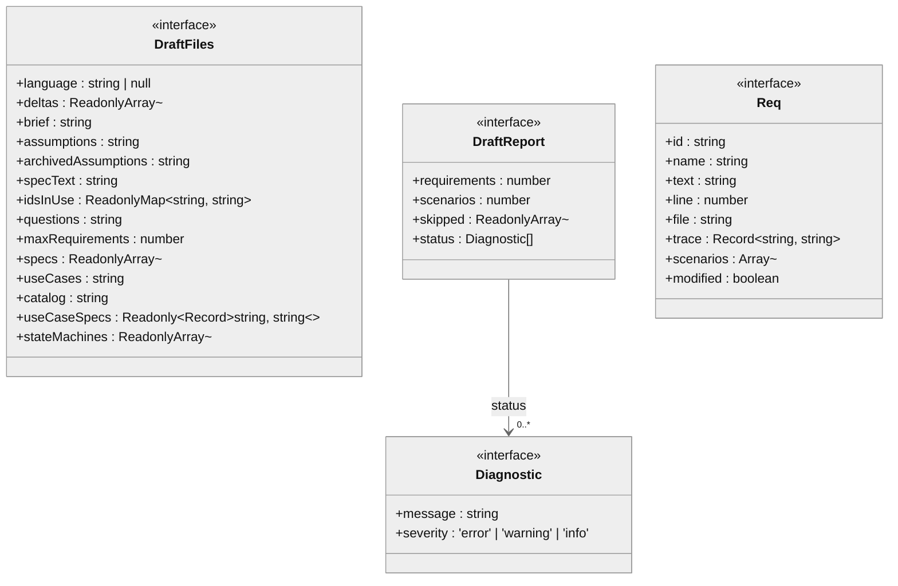

# Evidence — brief-quotes

> Written by `specgate evidence brief-quotes` (ADR-0047): each requirement before its code and after it.
> The screens are the last screenshot of each test; videos and traces stay in `.specgate/evidence/`, out of git.

## REQ-799 — A requirement's brief quote is in the brief

- No before: `specgate evidence before REQ-799`
- No screenshots: `specgate doctor` says how to have the runner keep them

### A quote the brief never wrote

· Drawn from the steps: no endpoint in the code answers them.

New since the base.

### The brief's sentence, wrapped and quoted

· Drawn from the steps: no endpoint in the code answers them.

New since the base.

### Classes — TypeScript

Changed: `Diagnostic` — added `+code : string`, `+target : string`, `+fix : string`, `+file : string`, `+line : number`.

At the base

