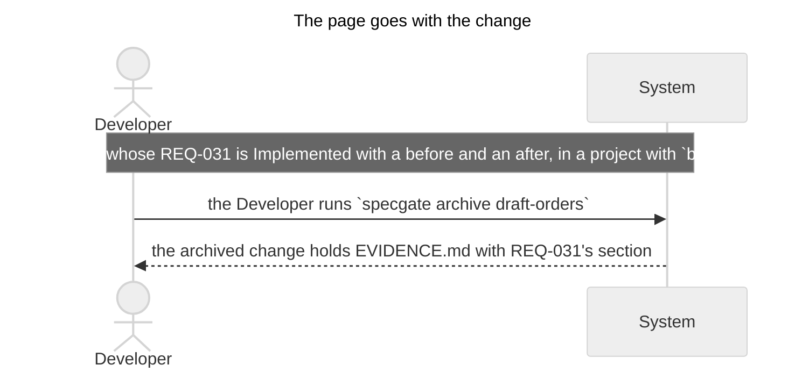
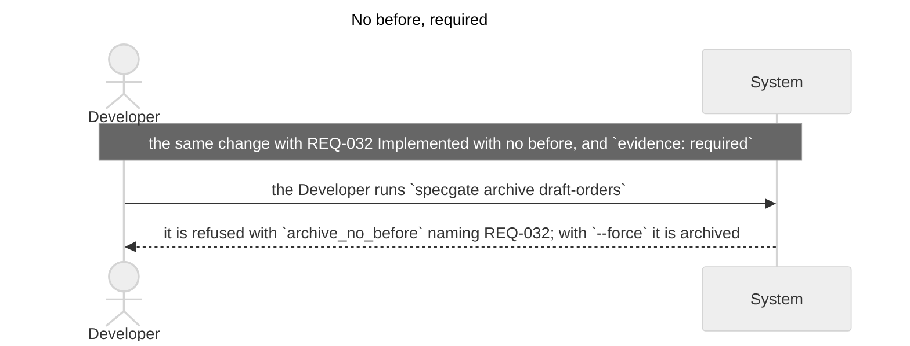
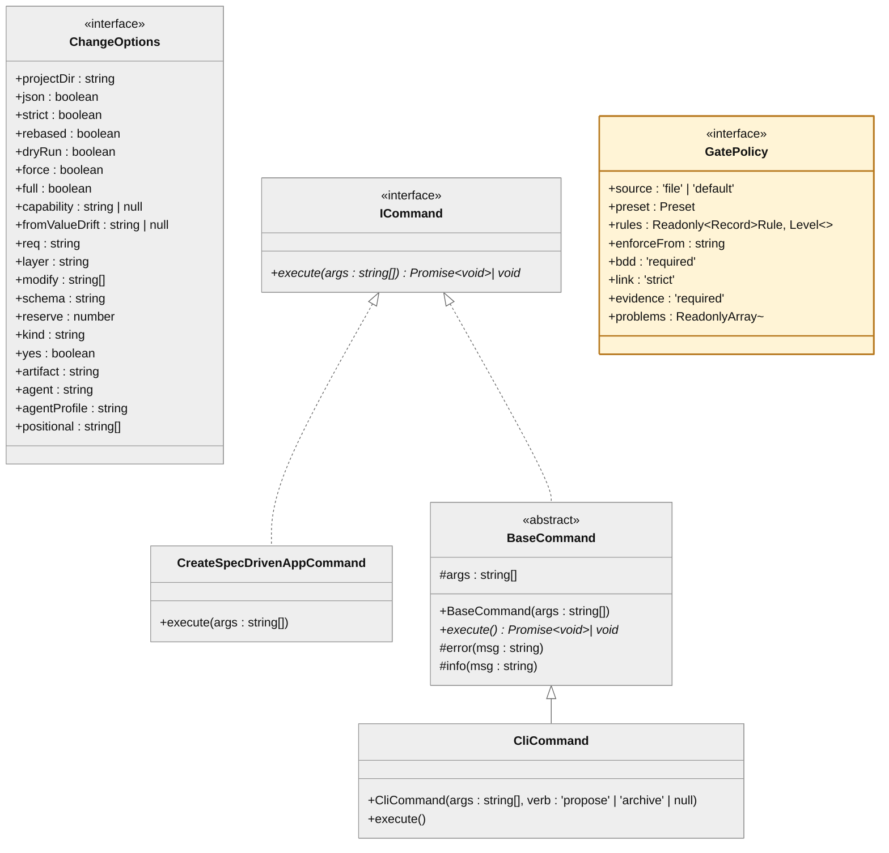
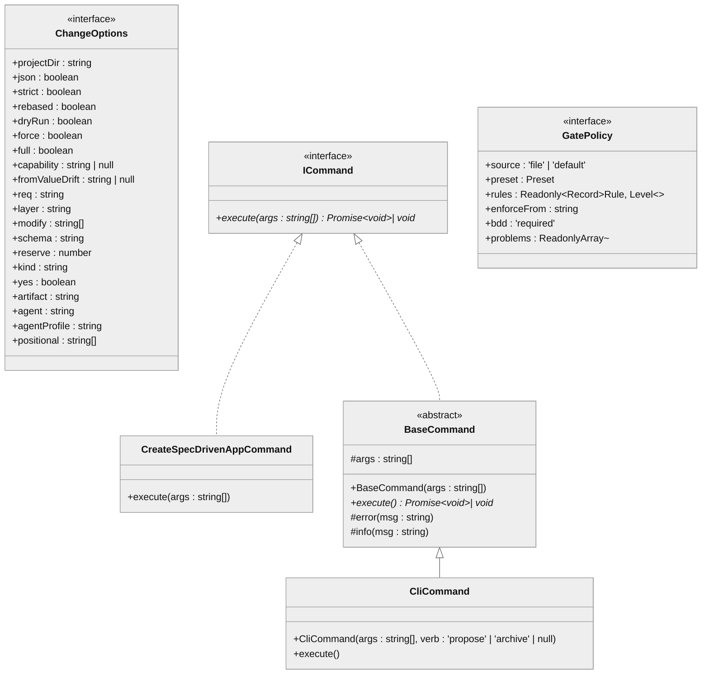
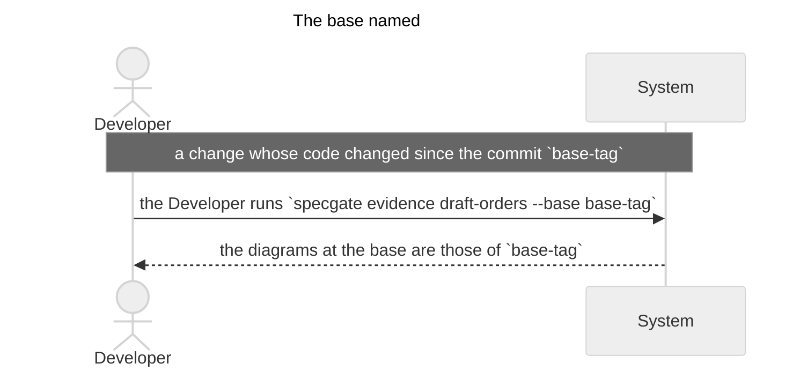
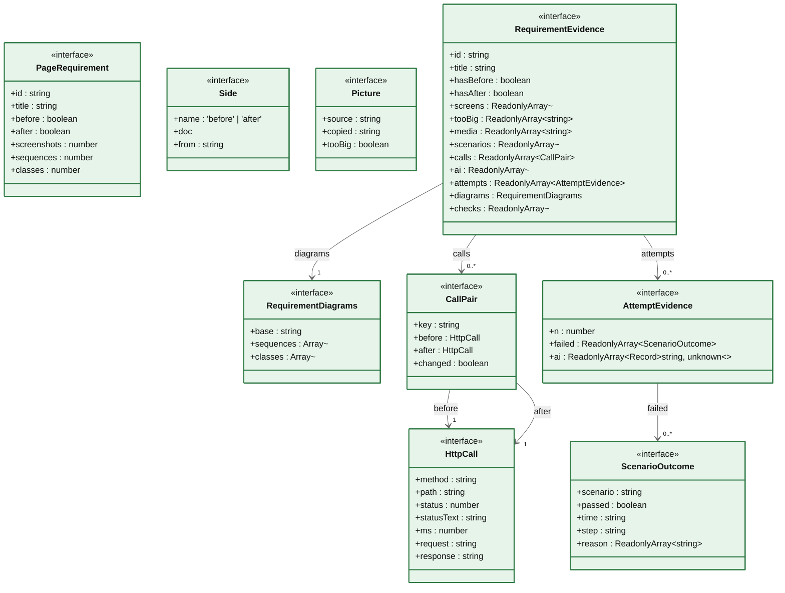

# Evidence — evidence-archive

> Written by `specgate evidence evidence-archive` (ADR-0047): each requirement before its code and after it.
> The screens are the last screenshot of each test; videos and traces stay in `.specgate/evidence/`, out of git.

## REQ-813 — Archive closes the change's evidence

- No before: `specgate evidence before REQ-813`
- No screenshots: `specgate doctor` says how to have the runner keep them

### The page goes with the change

· Drawn from the steps: no endpoint in the code answers them.

New since the base.

### No before, required

· Drawn from the steps: no endpoint in the code answers them.

New since the base.

### Classes — TypeScript

Changed: `GatePolicy` — added `+link : 'strict'`, `+evidence : 'required'`.

At the base

## REQ-814 — The evidence page compares with the base the person names

- No before: `specgate evidence before REQ-814`
- No screenshots: `specgate doctor` says how to have the runner keep them

### The base named

· Drawn from the steps: no endpoint in the code answers them.

New since the base.

### Classes — TypeScript

New since the base: `ScenarioOutcome`, `RequirementDiagrams`, `PageRequirement`, `Side`, `Picture`, `CallPair`, `RequirementEvidence`, `AttemptEvidence`, `HttpCall`.

New since the base.
