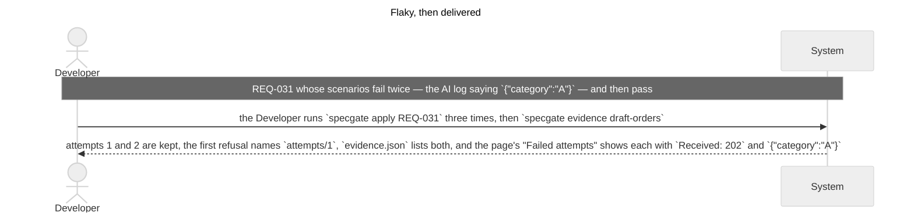
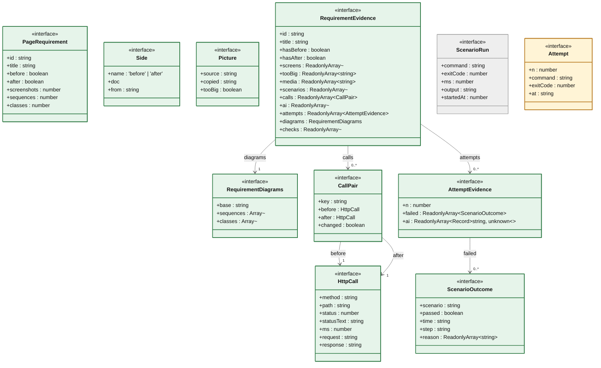
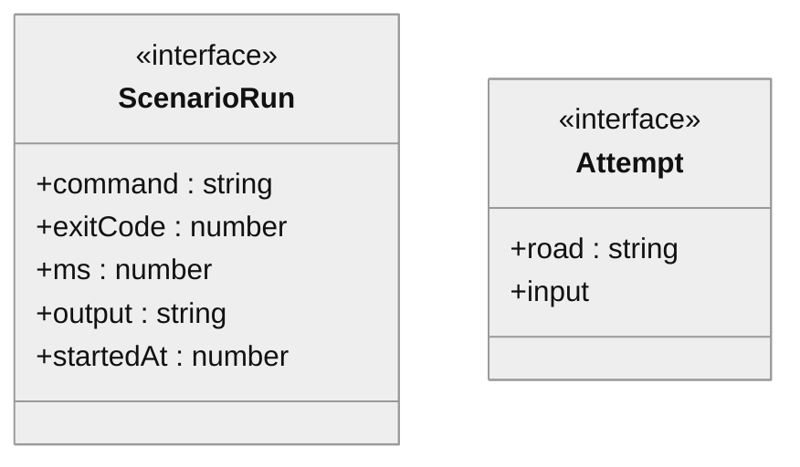

# Evidence — evidence-attempts

> Written by `specgate evidence evidence-attempts` (ADR-0047): each requirement before its code and after it.
> The screens are the last screenshot of each test; videos and traces stay in `.specgate/evidence/`, out of git.

## REQ-819 — A failed delivery is kept as an attempt

- No before: `specgate evidence before REQ-819`
- No screenshots: `specgate doctor` says how to have the runner keep them

### Flaky, then delivered

· Drawn from the steps: no endpoint in the code answers them.

New since the base.

### Classes — TypeScript

New since the base: `ScenarioOutcome`, `RequirementDiagrams`, `PageRequirement`, `Side`, `Picture`, `CallPair`, `RequirementEvidence`, `AttemptEvidence`, `HttpCall`. Changed: `Attempt` — added `+n : number`, `+command : string`, `+exitCode : number`, `+at : string` — removed `+road : string`, `+input`.

At the base

