# Evidence — evidence-before-after

> Written by `specgate evidence evidence-before-after` (ADR-0047): each requirement before its code and after it.
> The screens are the last screenshot of each test; videos and traces stay in `.specgate/evidence/`, out of git.

## REQ-803 — A requirement's run before its code is kept as its before

- No before: `specgate evidence before REQ-803`
- No screenshots: `specgate doctor` says how to have the runner keep them

### Before the code, red

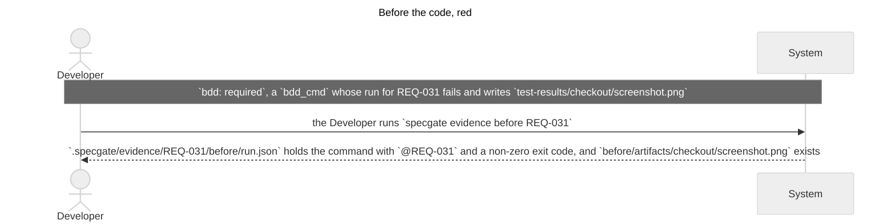

· Drawn from the steps: no endpoint in the code answers them.

New since the base.

### Classes — TypeScript

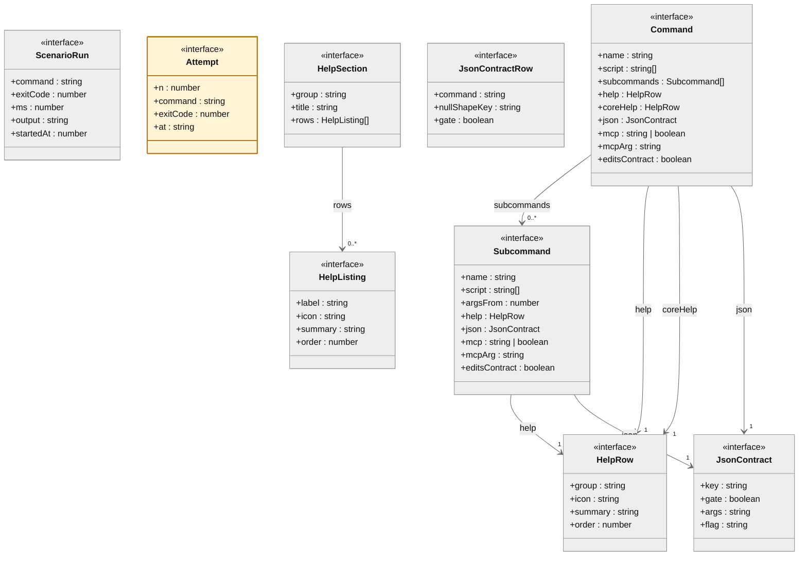

Changed: `Attempt` — added `+n : number`, `+command : string`, `+exitCode : number`, `+at : string` — removed `+road : string`, `+input`.

At the base

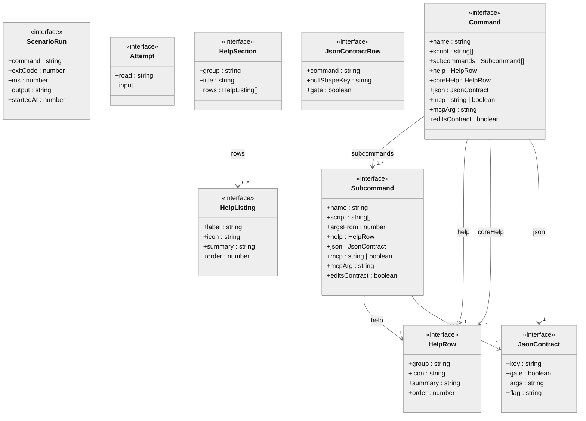

## REQ-804 — A delivery keeps its after beside its before

- No before: `specgate evidence before REQ-804`
- No screenshots: `specgate doctor` says how to have the runner keep them

### Delivered after its before

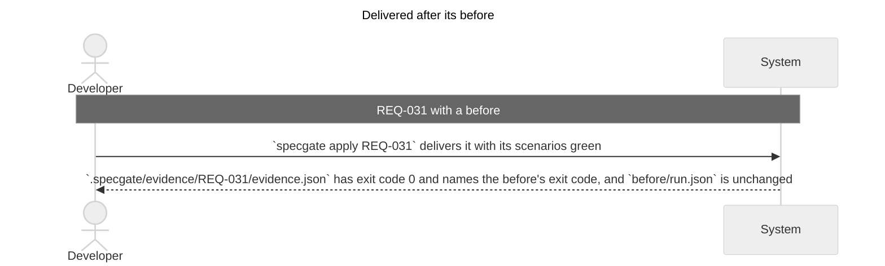

· Drawn from the steps: no endpoint in the code answers them.

New since the base.

### Classes — TypeScript

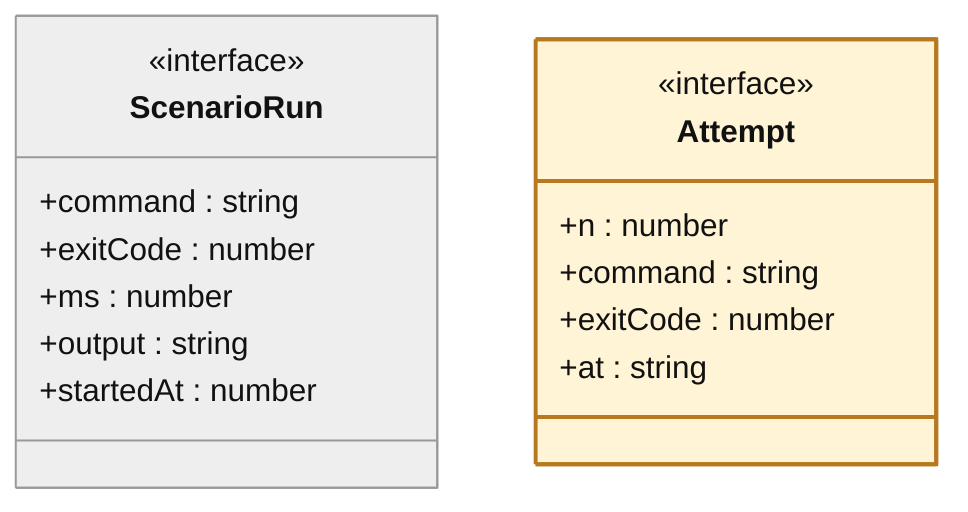

Changed: `Attempt` — added `+n : number`, `+command : string`, `+exitCode : number`, `+at : string` — removed `+road : string`, `+input`.

At the base

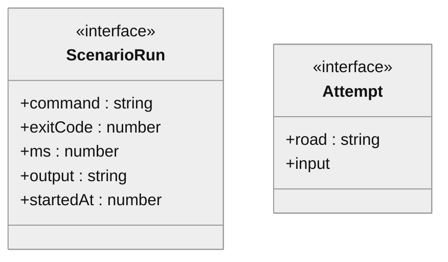

## REQ-805 — Doctor says when the runner keeps no pictures

- No before: `specgate evidence before REQ-805`
- No screenshots: `specgate doctor` says how to have the runner keep them

### Playwright without screenshots

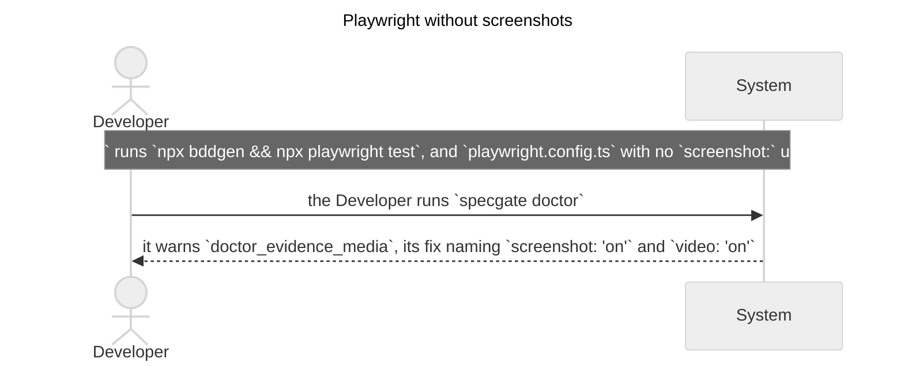

· Drawn from the steps: no endpoint in the code answers them.

New since the base.

### Classes — TypeScript

```mermaid
%%{init: {"theme": "neutral"}}%%
classDiagram
  class CreateSpecDrivenAppCommand {
    +execute(args : string[])
  }
  class Finding {
    <<interface>>
    +level : 'ok' | 'warn' | 'error'
    +check : string
    +detail : string
    +fix : string
  }
  class DoctorCommand {
    -findings : Finding[]
    +const
    -ok(check : string, detail : string)
    -warn(check : string, detail : string, fix : string)
    -recordError(check : string, detail : string, fix : string)
    -walk(dir : string) string[]
    -readIfExists(p : string) string | null
    -describeInstall()
    -checkEnvironment()
    -checkStructure(dir : string)
    -readSpecTree(dir : string) string | null
    -checkTraceability(dir : string)
    +if(spec)
  }
  class ICommand {
    <<interface>>
    +execute(args : string[])* Promise~void~| void
  }
  class BaseCommand {
    <<abstract>>
    #args : string[]
    +BaseCommand(args : string[])
    +execute()* Promise~void~| void
    #error(msg : string)
    #info(msg : string)
  }
  class BriefData {
    <<interface>>
    +exists : boolean
    +markdown : string
    +findings : Finding[]
  }
  class StatusAnswer {
    <<interface>>
    +schemaVersion : 1
    +projectDir : string
    +total : number
    +pending : number
    +counts : Record~string, number~
    +orphanFeatures : string[]
    +packs : unknown[]
    +requirements : Array~
    +brief
    +nextCommand : string | null
    +status : Finding[]
  }
  class QuestionsAnswer {
    <<interface>>
    +questions
    +status : Finding[]
  }
  class MatrixAnswer {
    <<interface>>
    +matrix
    +status : Finding[]
  }
  class ReportAnswer {
    <<interface>>
    +schemaVersion : 1
    +projectDir : string
    +total : number
    +implemented : number
    +pending : number
    +implementedPct : number
    +byCategory : Record~string, number~
    +needsTest : string[]
    +orphanFeatures : string[]
    +specops : unknown
    +requirements : Array~Record~string, unknown~&
    +declaredValues : unknown
    +coverage
    +capability : string
    +status : Finding[]
  }
  class GateStage {
    <<interface>>
    +stage : 'ids' | 'changes' | 'validate' | 'architecture' | 'tests' | 'quality'
    +name : string
    +gate : boolean
    +command : string | null
    +result : 'passed' | 'failed' | 'skipped' | 'not run'
    +ms : number | null
    +findings : Finding[]
  }
  class LastCheckAnswer {
    <<interface>>
    +lastCheck
    +status : Finding[]
  }
  class HarnessStopAnswer {
    <<interface>>
    +stop
    +status : Finding[]
  }
  class ChangeAnswer {
    <<interface>>
    +change
    +status : Finding[]
  }
  class BriefFormAnswer {
    <<interface>>
    +form : BriefForm
    +status : Finding[]
  }
  class AgentAskAnswer {
    <<interface>>
    +plan
    +status : Finding[]
  }
  ICommand <|.. CreateSpecDrivenAppCommand
  BaseCommand <|-- DoctorCommand
  ICommand <|.. BaseCommand
  DoctorCommand --> "0..*" Finding : findings
  BriefData --> "0..*" Finding : findings
  StatusAnswer --> "0..*" Finding : status
  QuestionsAnswer --> "0..*" Finding : status
  MatrixAnswer --> "0..*" Finding : status
  ReportAnswer --> "0..*" Finding : status
  GateStage --> "0..*" Finding : findings
  LastCheckAnswer --> "0..*" Finding : status
  HarnessStopAnswer --> "0..*" Finding : status
  ChangeAnswer --> "0..*" Finding : status
  BriefFormAnswer --> "0..*" Finding : status
  AgentAskAnswer --> "0..*" Finding : status
  style Finding fill:#fff4d6,stroke:#b7791f,stroke-width:2px
```

Changed: `Finding` — added `+level : 'ok' | 'warn' | 'error'`, `+check : string`, `+detail : string` — removed `+severity : 'error' | 'warning' | 'info'`, `+code : string`, `+message : string`, `+target : string`, `+file : string`, `+line : number`.

At the base

```mermaid
%%{init: {"theme": "neutral"}}%%
classDiagram
  class CreateSpecDrivenAppCommand {
    +execute(args : string[])
  }
  class Finding {
    <<interface>>
    +severity : 'error' | 'warning' | 'info'
    +code : string
    +message : string
    +target : string
    +fix : string
    +file : string
    +line : number
  }
  class DoctorCommand {
    -findings : Finding[]
    +const
    -ok(check : string, detail : string)
    -warn(check : string, detail : string, fix : string)
    -recordError(check : string, detail : string, fix : string)
    -walk(dir : string) string[]
    -readIfExists(p : string) string | null
    -describeInstall()
    -checkEnvironment()
    -checkStructure(dir : string)
    -readSpecTree(dir : string) string | null
    -checkTraceability(dir : string)
    +if(spec)
  }
  class ICommand {
    <<interface>>
    +execute(args : string[])* Promise~void~| void
  }
  class BaseCommand {
    <<abstract>>
    #args : string[]
    +BaseCommand(args : string[])
    +execute()* Promise~void~| void
    #error(msg : string)
    #info(msg : string)
  }
  class BriefData {
    <<interface>>
    +exists : boolean
    +markdown : string
    +findings : Finding[]
  }
  class StatusAnswer {
    <<interface>>
    +schemaVersion : 1
    +projectDir : string
    +total : number
    +pending : number
    +counts : Record~string, number~
    +orphanFeatures : string[]
    +packs : unknown[]
    +requirements : Array~
    +brief
    +nextCommand : string | null
    +status : Finding[]
  }
  class QuestionsAnswer {
    <<interface>>
    +questions
    +status : Finding[]
  }
  class MatrixAnswer {
    <<interface>>
    +matrix
    +status : Finding[]
  }
  class ReportAnswer {
    <<interface>>
    +schemaVersion : 1
    +projectDir : string
    +total : number
    +implemented : number
    +pending : number
    +implementedPct : number
    +byCategory : Record~string, number~
    +needsTest : string[]
    +orphanFeatures : string[]
    +specops : unknown
    +requirements : Array~Record~string, unknown~&
    +declaredValues : unknown
    +coverage
    +capability : string
    +status : Finding[]
  }
  class GateStage {
    <<interface>>
    +stage : 'ids' | 'changes' | 'validate' | 'architecture' | 'tests' | 'quality'
    +name : string
    +gate : boolean
    +command : string | null
    +result : 'passed' | 'failed' | 'skipped' | 'not run'
    +ms : number | null
    +findings : Finding[]
  }
  class LastCheckAnswer {
    <<interface>>
    +lastCheck
    +status : Finding[]
  }
  class HarnessStopAnswer {
    <<interface>>
    +stop
    +status : Finding[]
  }
  class ChangeAnswer {
    <<interface>>
    +change
    +status : Finding[]
  }
  class BriefFormAnswer {
    <<interface>>
    +form : BriefForm
    +status : Finding[]
  }
  class AgentAskAnswer {
    <<interface>>
    +plan
    +status : Finding[]
  }
  ICommand <|.. CreateSpecDrivenAppCommand
  BaseCommand <|-- DoctorCommand
  ICommand <|.. BaseCommand
  DoctorCommand --> "0..*" Finding : findings
  BriefData --> "0..*" Finding : findings
  StatusAnswer --> "0..*" Finding : status
  QuestionsAnswer --> "0..*" Finding : status
  MatrixAnswer --> "0..*" Finding : status
  ReportAnswer --> "0..*" Finding : status
  GateStage --> "0..*" Finding : findings
  LastCheckAnswer --> "0..*" Finding : status
  HarnessStopAnswer --> "0..*" Finding : status
  ChangeAnswer --> "0..*" Finding : status
  BriefFormAnswer --> "0..*" Finding : status
  AgentAskAnswer --> "0..*" Finding : status
```

## REQ-806 — A requirement is drawn before and after, the same way every time

- No before: `specgate evidence before REQ-806`
- No screenshots: `specgate doctor` says how to have the runner keep them

### A call added to a flow

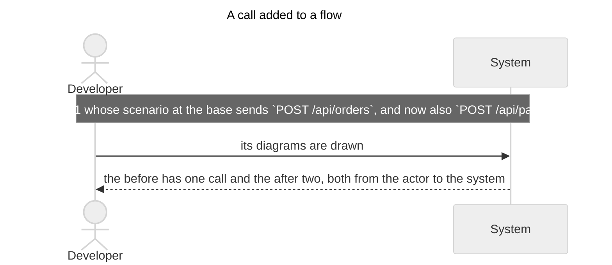

· Drawn from the steps: no endpoint in the code answers them.

New since the base.

### A method added to a class

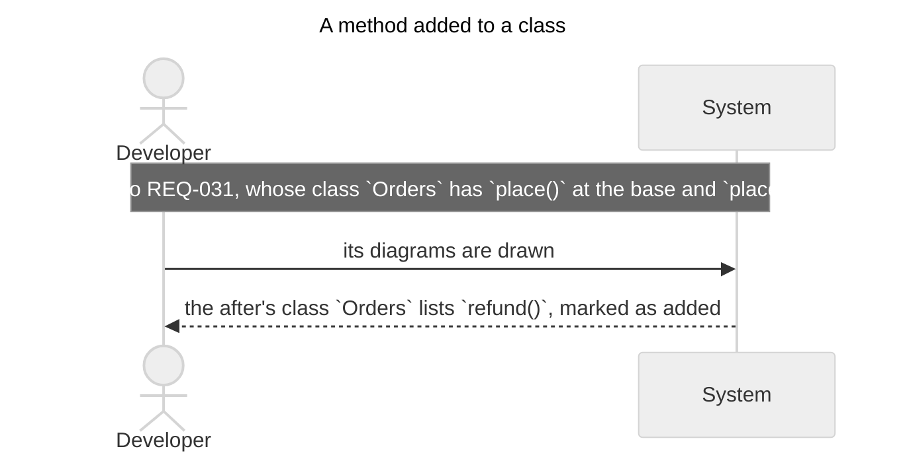

· Drawn from the steps: no endpoint in the code answers them.

New since the base.

### Classes — TypeScript

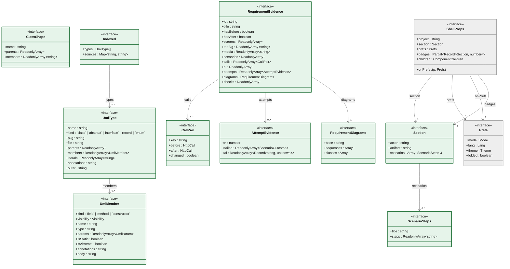

New since the base: `ScenarioSteps`, `ClassShape`, `UmlMember`, `UmlType`, `RequirementDiagrams`, `Section`, `Indexed`, `CallPair`, `RequirementEvidence`, `AttemptEvidence`.

At the base

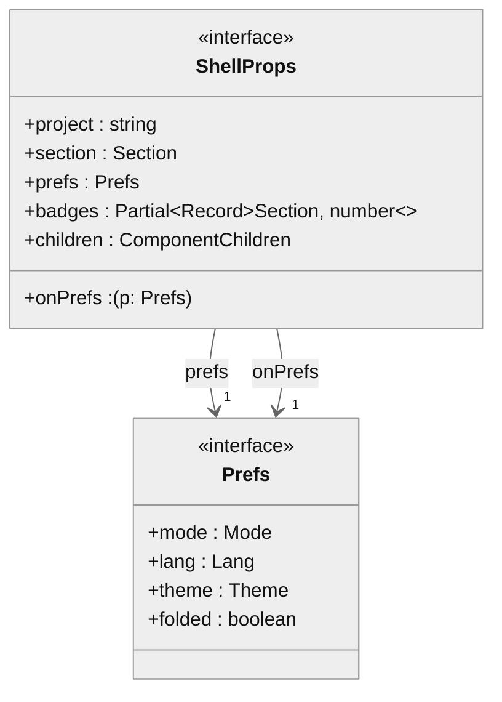

## REQ-807 — One page shows a change's evidence

- No before: `specgate evidence before REQ-807`
- No screenshots: `specgate doctor` says how to have the runner keep them

### One before, one missing

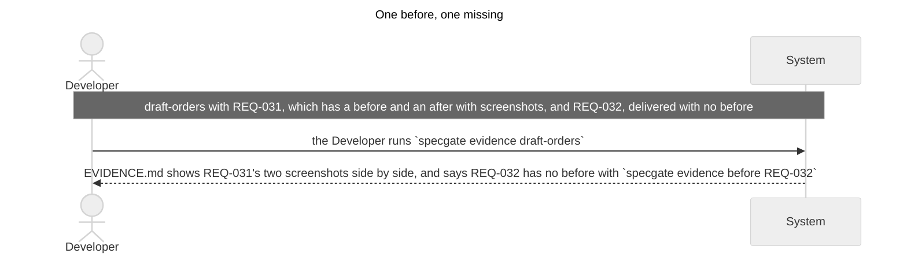

· Drawn from the steps: no endpoint in the code answers them.

New since the base.

### Classes — TypeScript

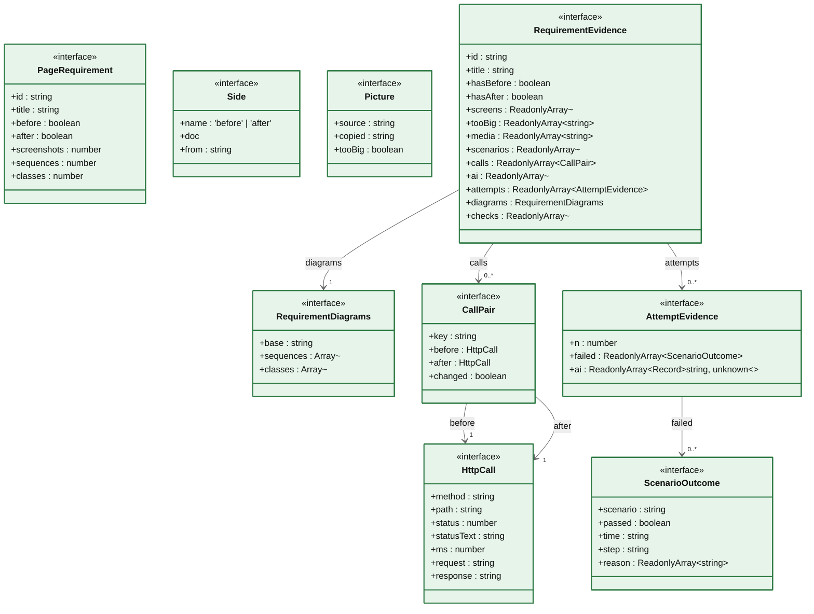

New since the base: `ScenarioOutcome`, `RequirementDiagrams`, `PageRequirement`, `Side`, `Picture`, `CallPair`, `RequirementEvidence`, `AttemptEvidence`, `HttpCall`.

New since the base.
