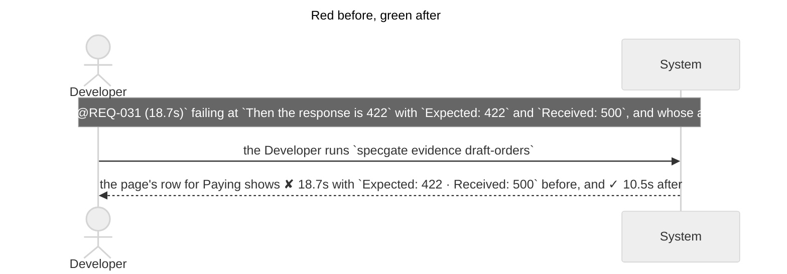
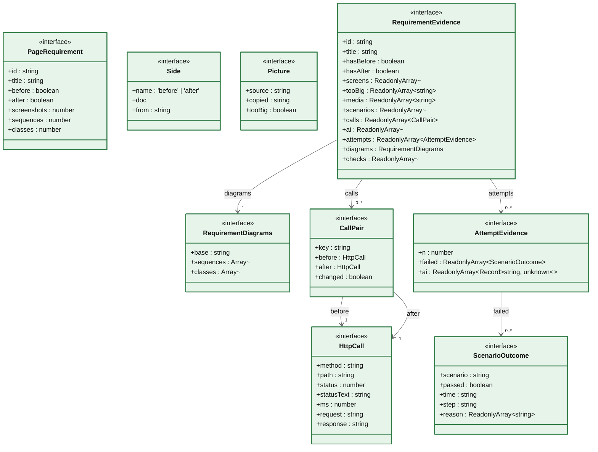
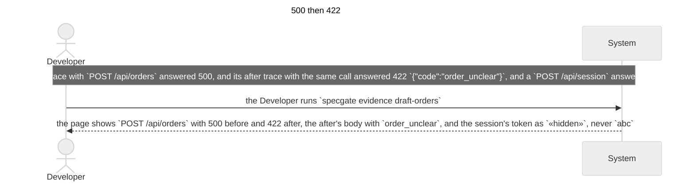
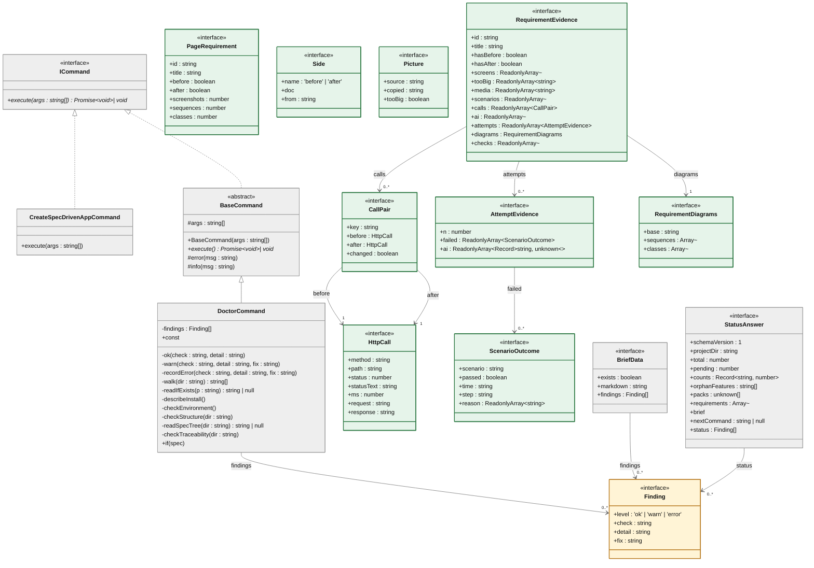
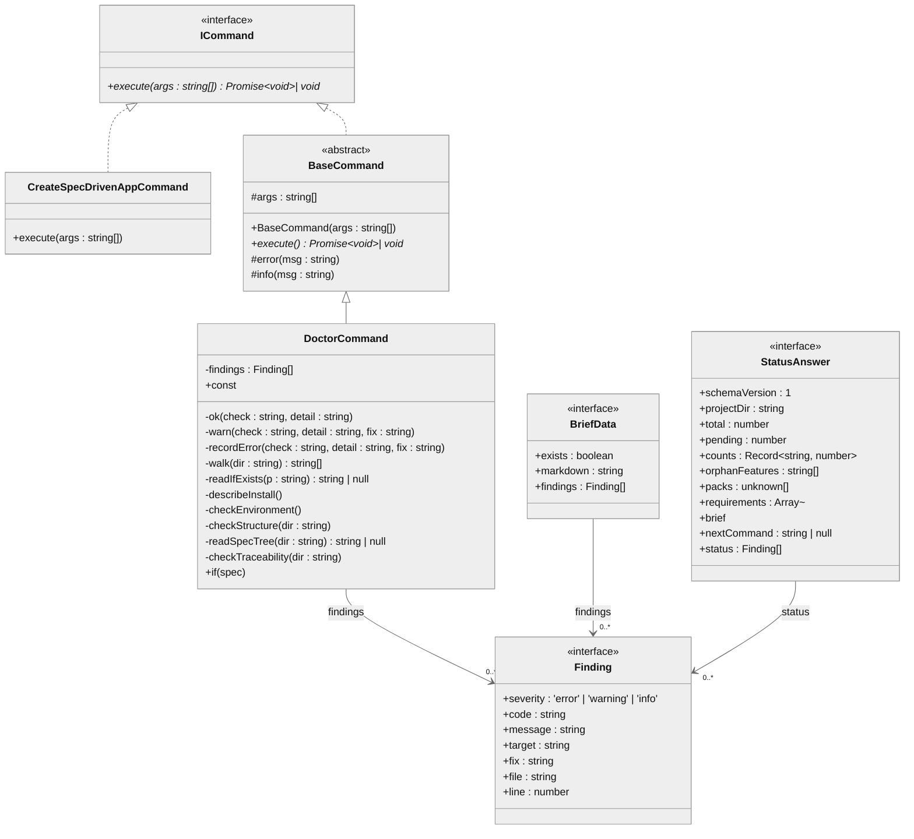
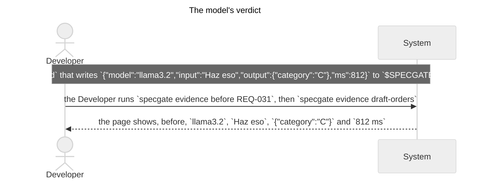
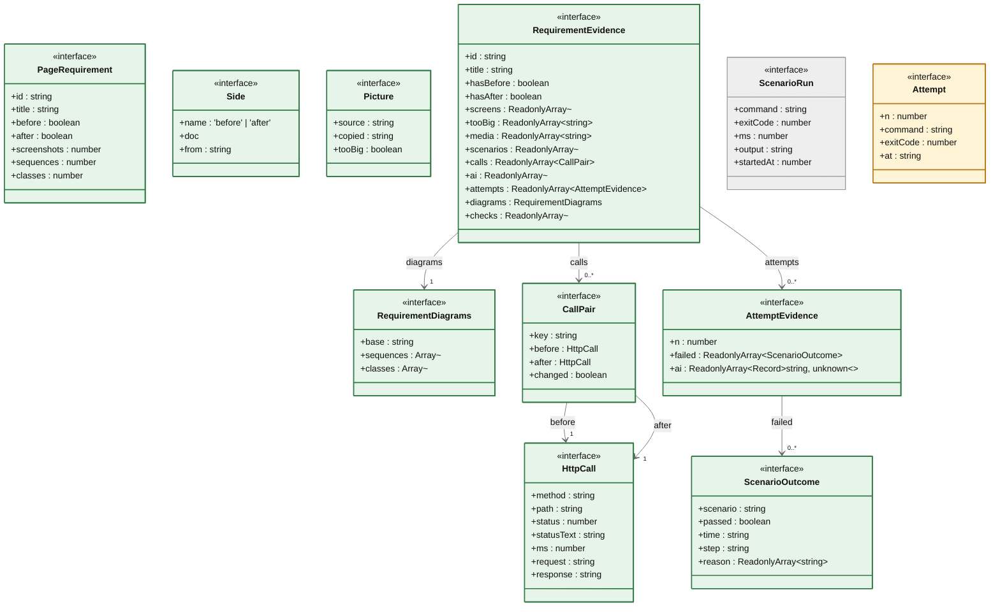
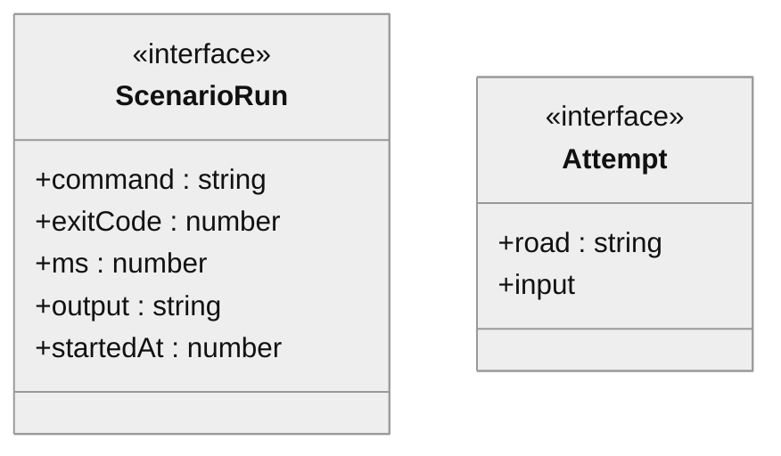

# Evidence — evidence-details

> Written by `specgate evidence evidence-details` (ADR-0047): each requirement before its code and after it.
> The screens are the last screenshot of each test; videos and traces stay in `.specgate/evidence/`, out of git.

## REQ-815 — The page says why each scenario was red

- No before: `specgate evidence before REQ-815`
- No screenshots: `specgate doctor` says how to have the runner keep them

### Red before, green after

· Drawn from the steps: no endpoint in the code answers them.

New since the base.

### Classes — TypeScript

New since the base: `ScenarioOutcome`, `RequirementDiagrams`, `PageRequirement`, `Side`, `Picture`, `CallPair`, `RequirementEvidence`, `AttemptEvidence`, `HttpCall`.

New since the base.

## REQ-816 — The page shows each call to the service, before and after

- No before: `specgate evidence before REQ-816`
- No screenshots: `specgate doctor` says how to have the runner keep them

### 500 then 422

· Drawn from the steps: no endpoint in the code answers them.

New since the base.

### Classes — TypeScript

New since the base: `ScenarioOutcome`, `RequirementDiagrams`, `PageRequirement`, `Side`, `Picture`, `CallPair`, `RequirementEvidence`, `AttemptEvidence`, `HttpCall`. Changed: `Finding` — added `+level : 'ok' | 'warn' | 'error'`, `+check : string`, `+detail : string` — removed `+severity : 'error' | 'warning' | 'info'`, `+code : string`, `+message : string`, `+target : string`, `+file : string`, `+line : number`.

At the base

## REQ-817 — The page shows what the AI model decided

- No before: `specgate evidence before REQ-817`
- No screenshots: `specgate doctor` says how to have the runner keep them

### The model's verdict

· Drawn from the steps: no endpoint in the code answers them.

New since the base.

### Classes — TypeScript

New since the base: `ScenarioOutcome`, `RequirementDiagrams`, `PageRequirement`, `Side`, `Picture`, `CallPair`, `RequirementEvidence`, `AttemptEvidence`, `HttpCall`. Changed: `Attempt` — added `+n : number`, `+command : string`, `+exitCode : number`, `+at : string` — removed `+road : string`, `+input`.

At the base

