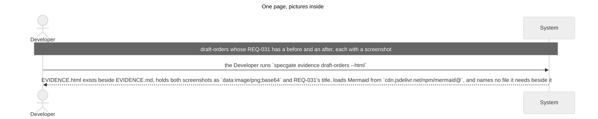
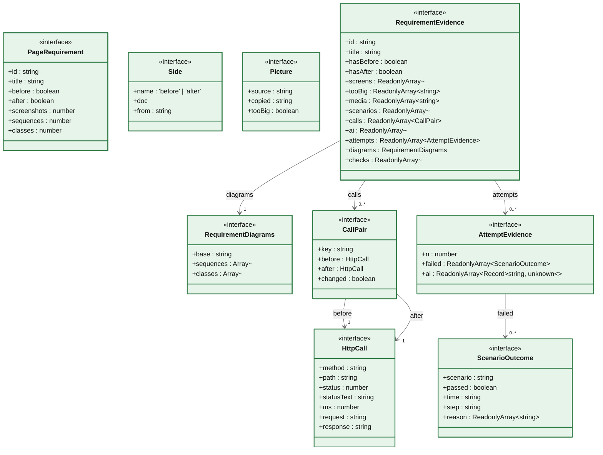

# Evidence — evidence-html

> Written by `specgate evidence evidence-html` (ADR-0047): each requirement before its code and after it.
> The screens are the last screenshot of each test; videos and traces stay in `.specgate/evidence/`, out of git.

## REQ-818 — The evidence as one web page

- No before: `specgate evidence before REQ-818`
- No screenshots: `specgate doctor` says how to have the runner keep them

### One page, pictures inside

· Drawn from the steps: no endpoint in the code answers them.

New since the base.

### Classes — TypeScript

New since the base: `ScenarioOutcome`, `RequirementDiagrams`, `PageRequirement`, `Side`, `Picture`, `CallPair`, `RequirementEvidence`, `AttemptEvidence`, `HttpCall`.

New since the base.
