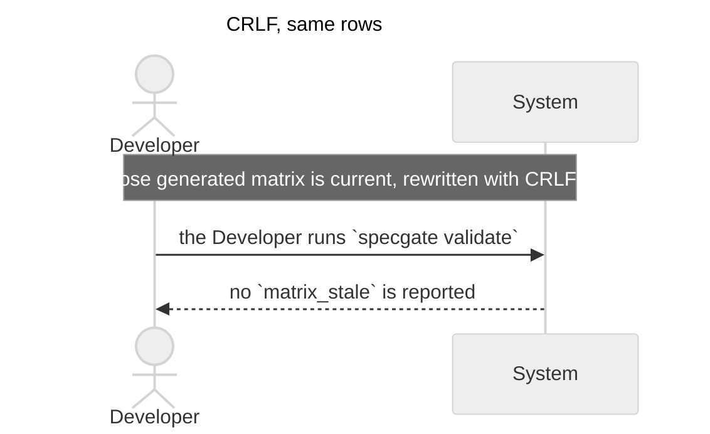
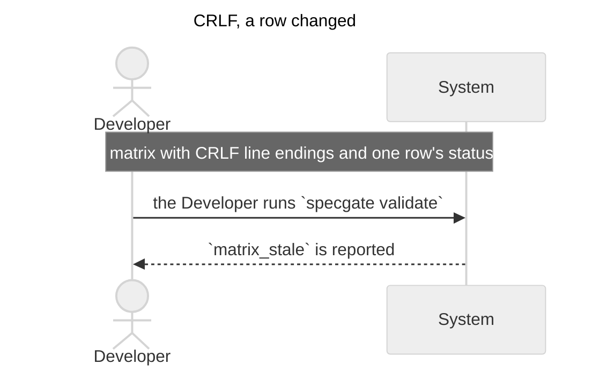

# Evidence — matrix-line-endings

> Written by `specgate evidence matrix-line-endings` (ADR-0047): each requirement before its code and after it.
> The screens are the last screenshot of each test; videos and traces stay in `.specgate/evidence/`, out of git.

## REQ-808 — A matrix checked out with CRLF is current

- No before: `specgate evidence before REQ-808`
- No screenshots: `specgate doctor` says how to have the runner keep them

### CRLF, same rows

· Drawn from the steps: no endpoint in the code answers them.

New since the base.

### CRLF, a row changed

· Drawn from the steps: no endpoint in the code answers them.

New since the base.
