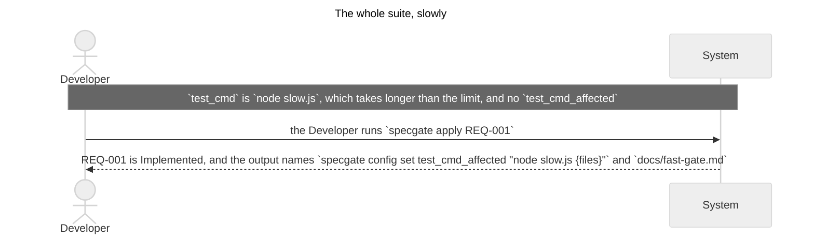
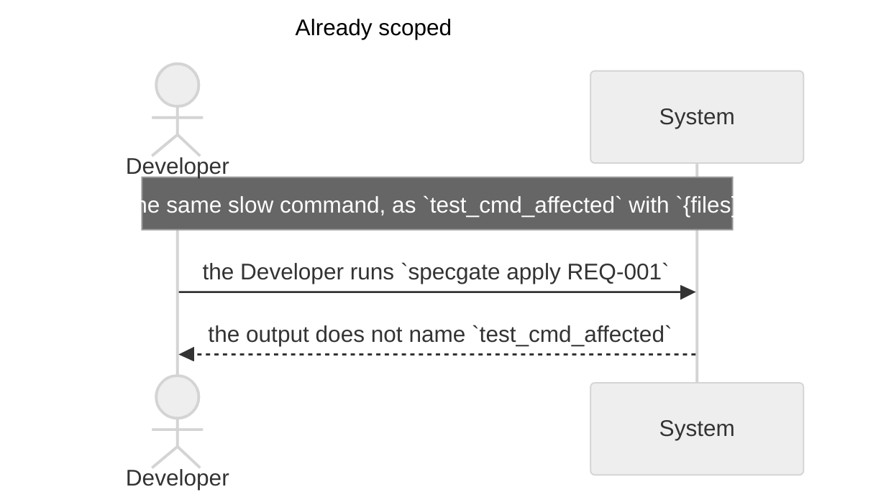

# Evidence — slow-tests-hint

> Written by `specgate evidence slow-tests-hint` (ADR-0047): each requirement before its code and after it.
> The screens are the last screenshot of each test; videos and traces stay in `.specgate/evidence/`, out of git.

## REQ-802 — A slow delivery names the faster command

- No before: `specgate evidence before REQ-802`
- No screenshots: `specgate doctor` says how to have the runner keep them

### The whole suite, slowly

· Drawn from the steps: no endpoint in the code answers them.

New since the base.

### Already scoped

· Drawn from the steps: no endpoint in the code answers them.

New since the base.
