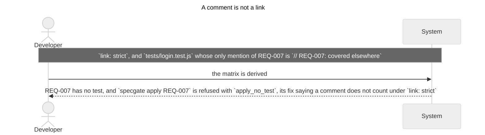
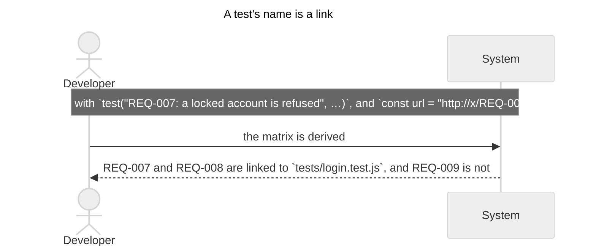
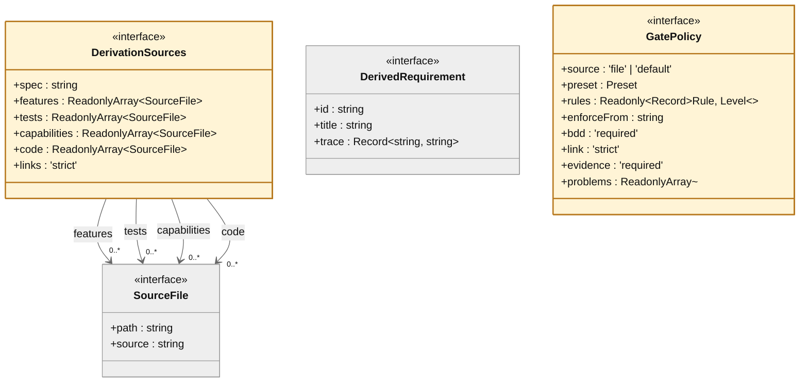
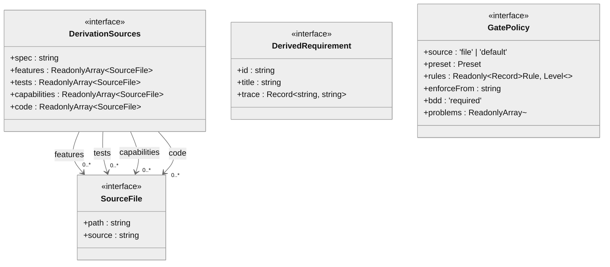
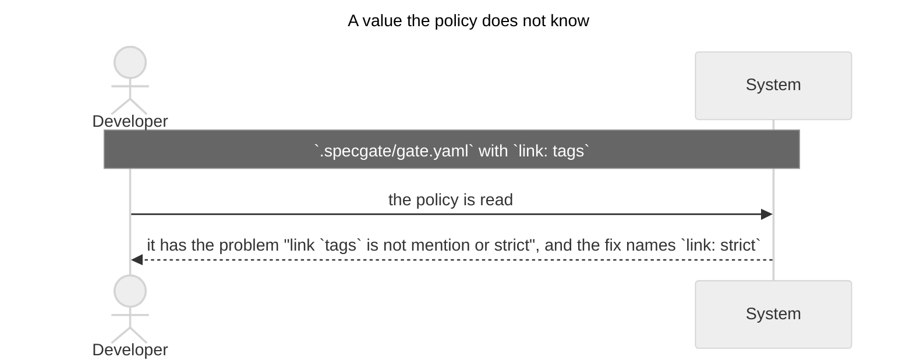
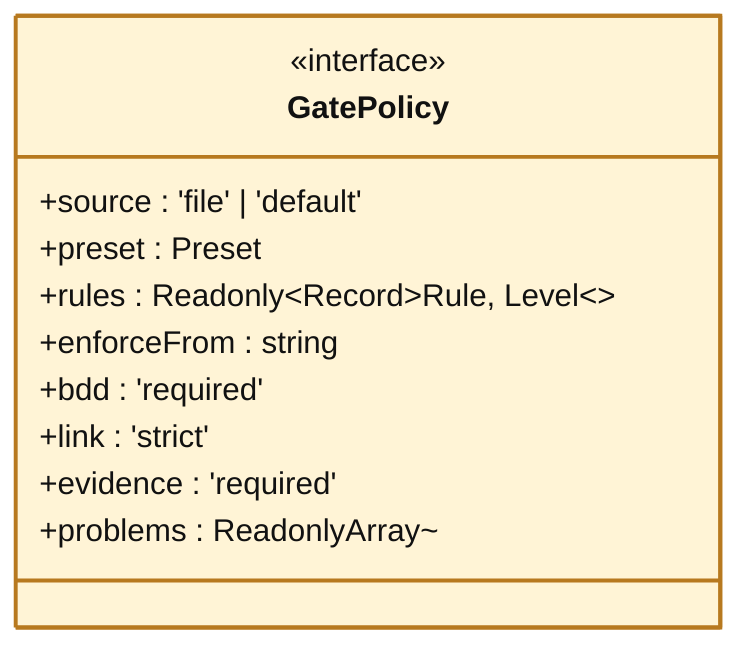
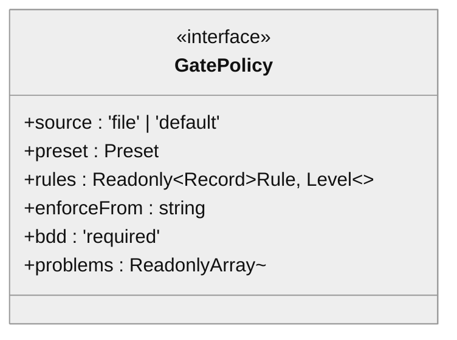

# Evidence — strict-links

> Written by `specgate evidence strict-links` (ADR-0047): each requirement before its code and after it.
> The screens are the last screenshot of each test; videos and traces stay in `.specgate/evidence/`, out of git.

## REQ-800 — With `link: strict`, a comment does not link a test

- No before: `specgate evidence before REQ-800`
- No screenshots: `specgate doctor` says how to have the runner keep them

### A comment is not a link

· Drawn from the steps: no endpoint in the code answers them.

New since the base.

### A test's name is a link

· Drawn from the steps: no endpoint in the code answers them.

New since the base.

### Classes — TypeScript

Changed: `DerivationSources` — added `+links : 'strict'`. Changed: `GatePolicy` — added `+link : 'strict'`, `+evidence : 'required'`.

At the base

## REQ-801 — The gate policy reads `link`

- No before: `specgate evidence before REQ-801`
- No screenshots: `specgate doctor` says how to have the runner keep them

### A value the policy does not know

· Drawn from the steps: no endpoint in the code answers them.

New since the base.

### Classes — TypeScript

Changed: `GatePolicy` — added `+link : 'strict'`, `+evidence : 'required'`.

At the base

