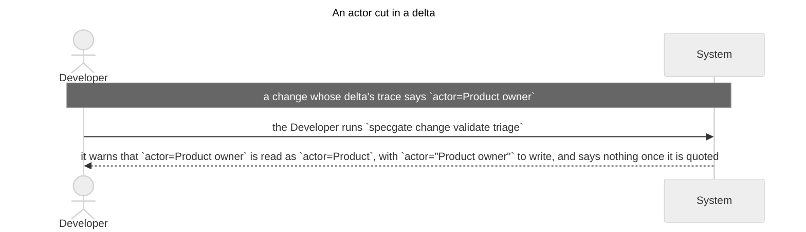
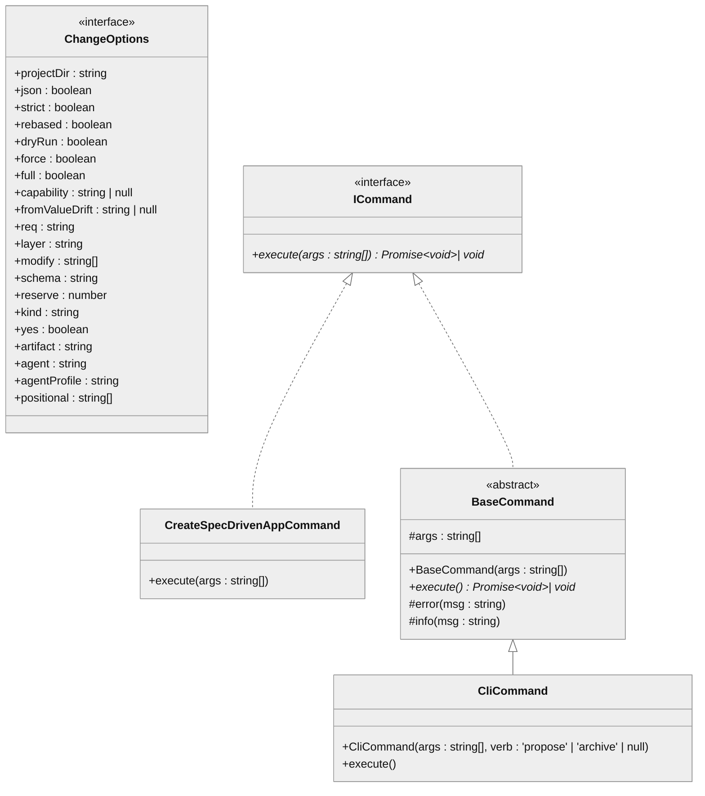

# Evidence — trace-in-deltas

> Written by `specgate evidence trace-in-deltas` (ADR-0047): each requirement before its code and after it.
> The screens are the last screenshot of each test; videos and traces stay in `.specgate/evidence/`, out of git.

## REQ-825 — A delta's trace value cut at a space is reported

- No before: `specgate evidence before REQ-825`
- No screenshots: `specgate doctor` says how to have the runner keep them

### An actor cut in a delta

· Drawn from the steps: no endpoint in the code answers them.

New since the base.

### Classes — TypeScript

At the base

