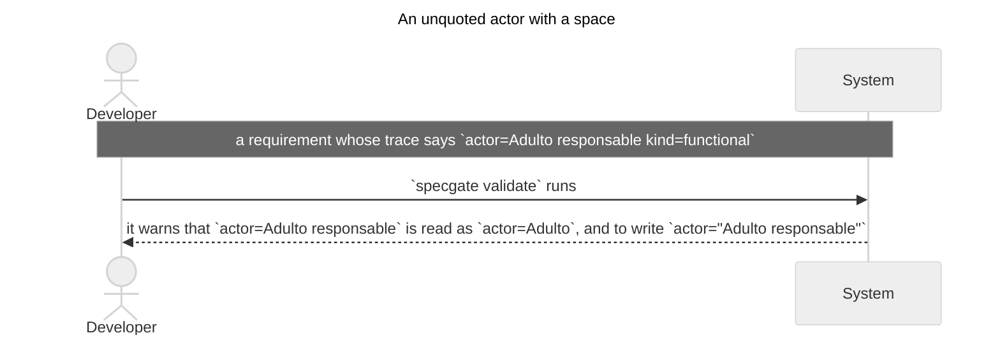
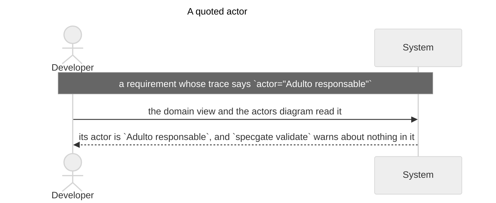
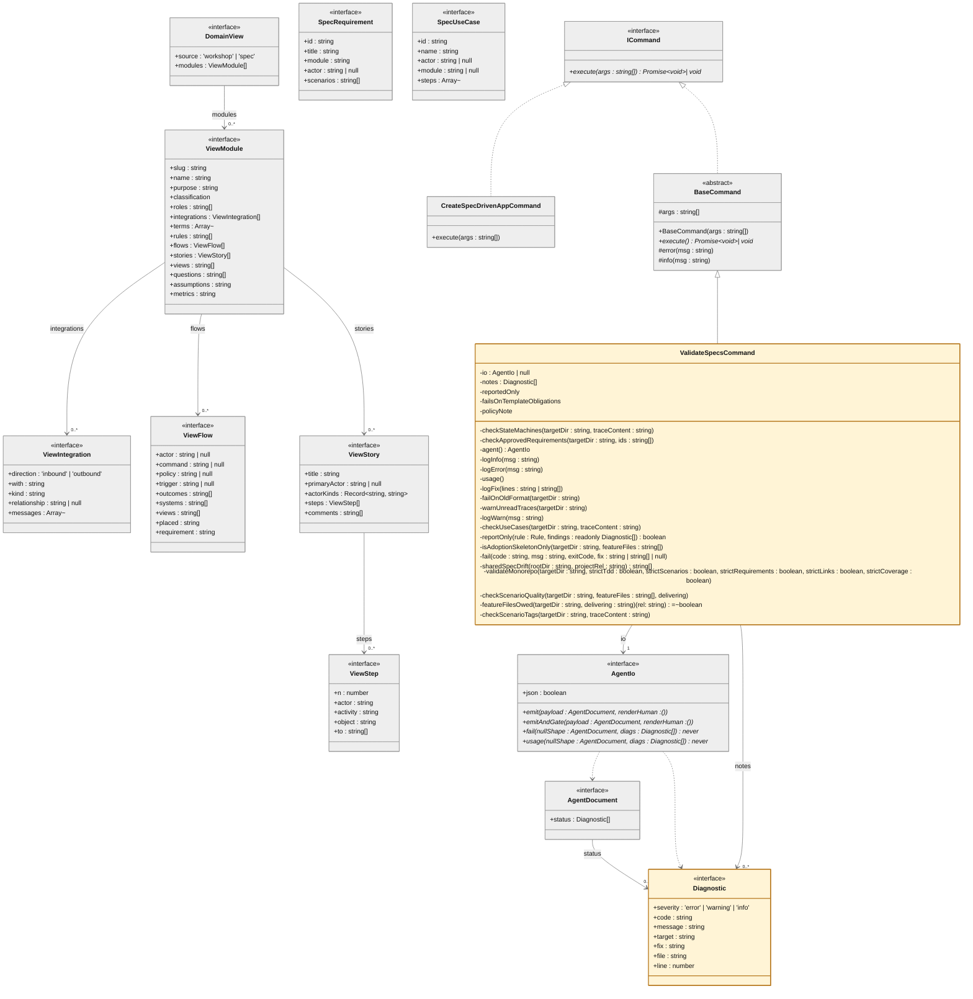
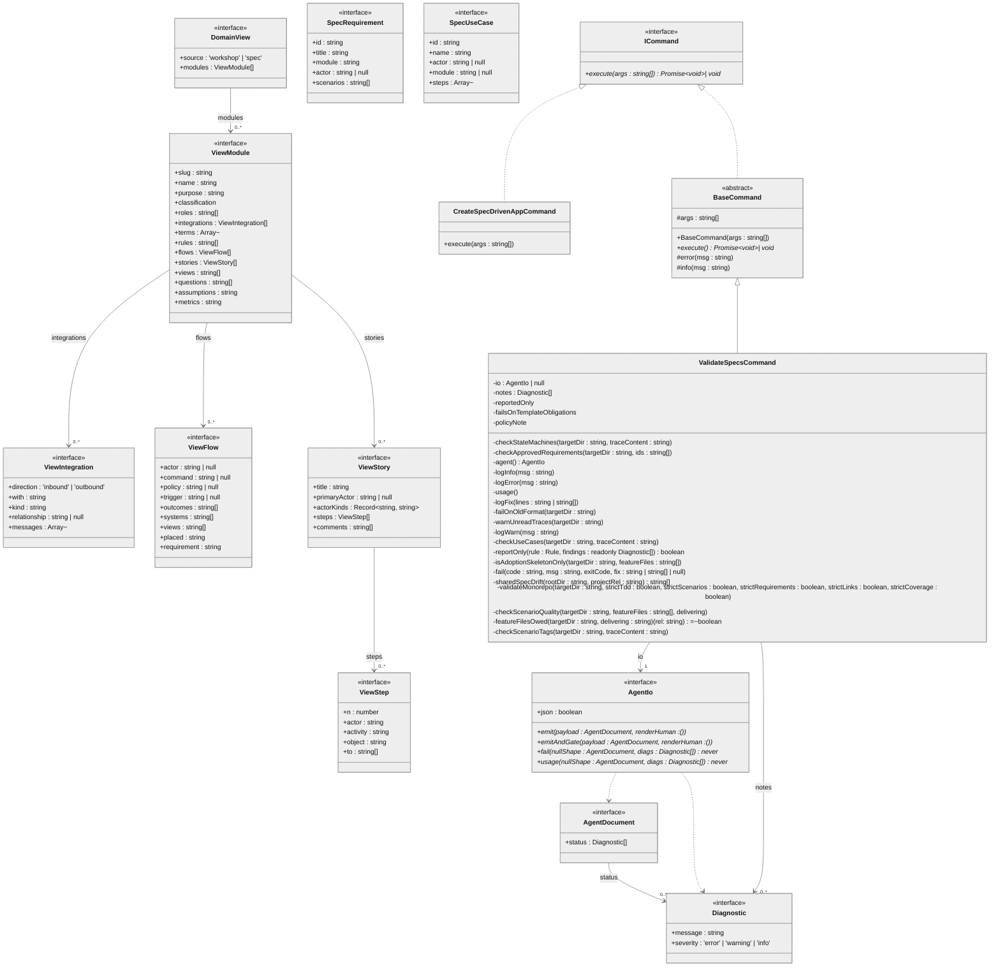

# Evidence — trace-values

> Written by `specgate evidence trace-values` (ADR-0047): each requirement before its code and after it.
> The screens are the last screenshot of each test; videos and traces stay in `.specgate/evidence/`, out of git.

## REQ-798 — A trace value cut at a space is reported, and read alike everywhere

- No before: `specgate evidence before REQ-798`
- No screenshots: `specgate doctor` says how to have the runner keep them

### An unquoted actor with a space

· Drawn from the steps: no endpoint in the code answers them.

New since the base.

### A quoted actor

· Drawn from the steps: no endpoint in the code answers them.

New since the base.

### Classes — TypeScript

Changed: `Diagnostic` — added `+code : string`, `+target : string`, `+fix : string`, `+file : string`, `+line : number`. Changed: `ValidateSpecsCommand` — `warnUnreadTraces()` rewritten.

At the base

