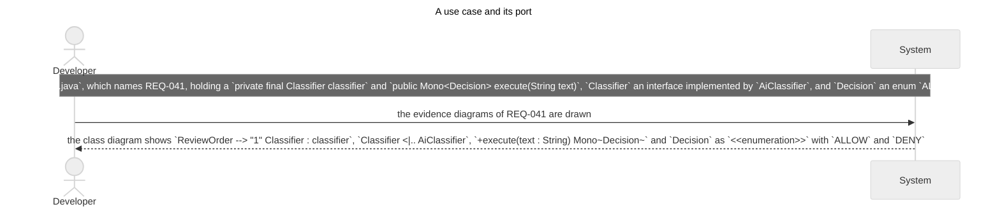
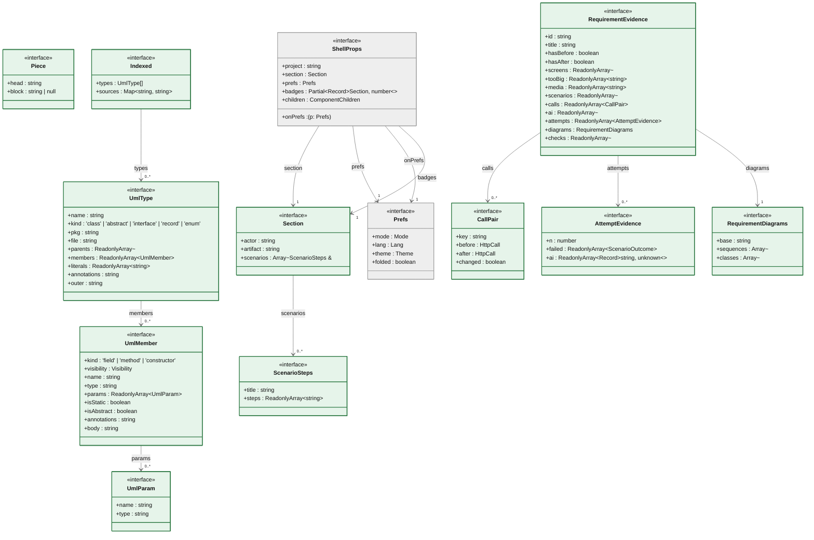
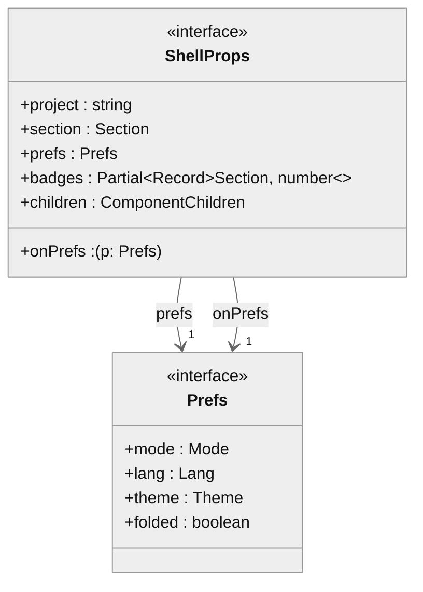
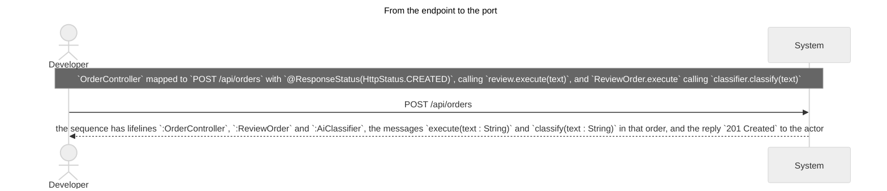
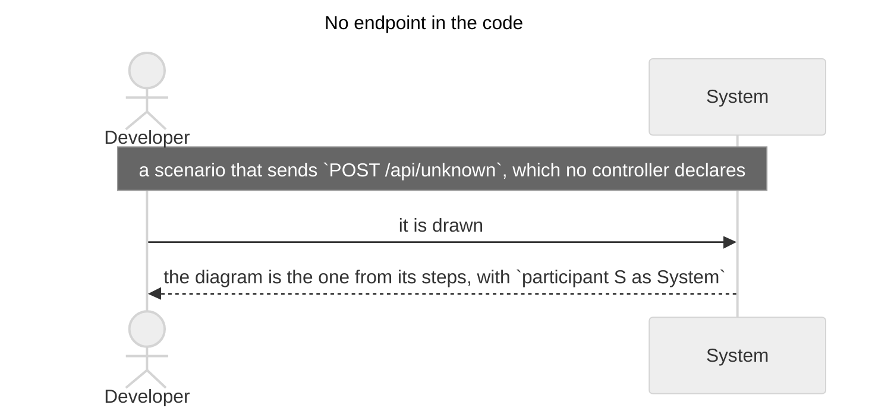

# Evidence — uml-evidence

> Written by `specgate evidence uml-evidence` (ADR-0047): each requirement before its code and after it.
> The screens are the last screenshot of each test; videos and traces stay in `.specgate/evidence/`, out of git.

## REQ-811 — The requirement's code as a UML class diagram

- No before: `specgate evidence before REQ-811`
- No screenshots: `specgate doctor` says how to have the runner keep them

### A use case and its port

· Drawn from the steps: no endpoint in the code answers them.

New since the base.

### Classes — TypeScript

New since the base: `ScenarioSteps`, `UmlParam`, `UmlMember`, `UmlType`, `Piece`, `RequirementDiagrams`, `Section`, `Indexed`, `CallPair`, `RequirementEvidence`, `AttemptEvidence`.

At the base

## REQ-812 — A scenario followed through the code as a UML sequence

- No before: `specgate evidence before REQ-812`
- No screenshots: `specgate doctor` says how to have the runner keep them

### From the endpoint to the port

· Read from the code, not checked against the run: its trace holds no call to the service — a call made from the server, out of the browser's sight, is not in it.

New since the base.

### No endpoint in the code

· Drawn from the steps: no endpoint in the code answers them.

New since the base.

### Classes — TypeScript

New since the base: `ScenarioSteps`, `UmlParam`, `UmlMember`, `UmlType`, `Piece`, `RequirementDiagrams`, `Section`, `Indexed`, `CallPair`, `RequirementEvidence`, `AttemptEvidence`.

At the base

