# Evidence — urbanops-run

> Written by `specgate evidence urbanops-run` (ADR-0047): each requirement before its code and after it.
> The screens are the last screenshot of each test; videos and traces stay in `.specgate/evidence/`, out of git.

## REQ-820 — Determining whether is no condition

- No before: `specgate evidence before REQ-820`
- No screenshots: `specgate doctor` says how to have the runner keep them

### The operator determines whether

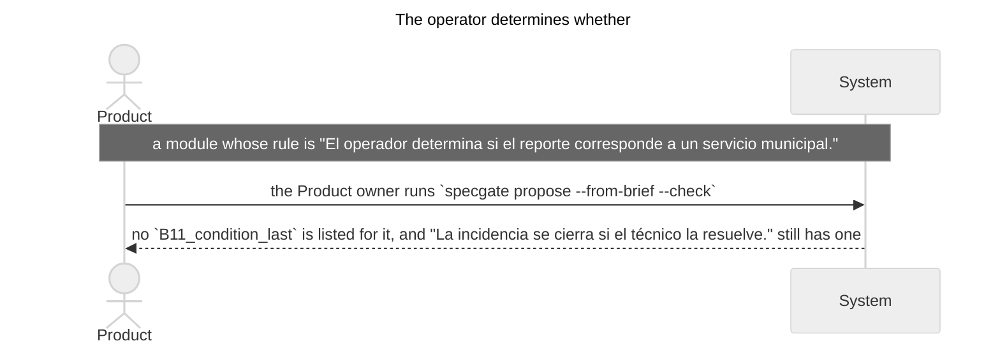

· Drawn from the steps: no endpoint in the code answers them.

New since the base.

### Classes — TypeScript

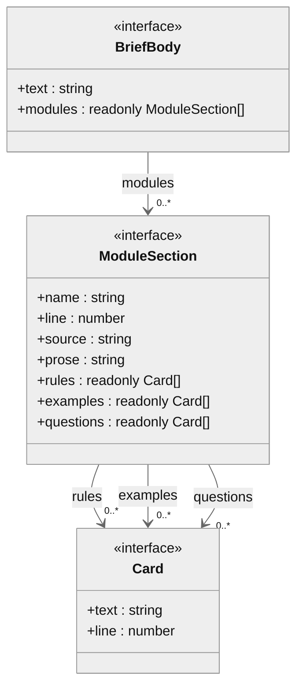

At the base

## REQ-821 — On main, the evidence compares with the commit before the change

- No before: `specgate evidence before REQ-821`
- No screenshots: `specgate doctor` says how to have the runner keep them

### Delivered on main

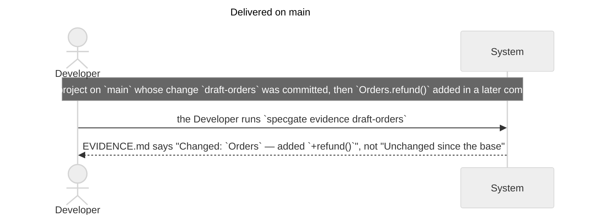

· Drawn from the steps: no endpoint in the code answers them.

New since the base.

### Classes — TypeScript

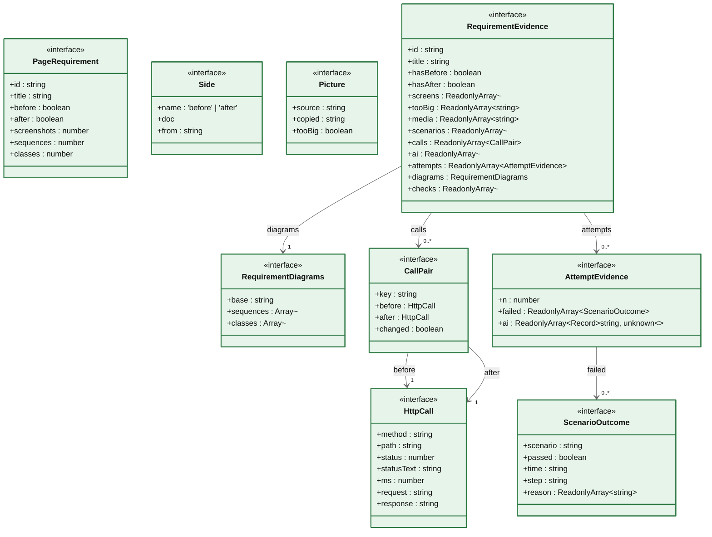

New since the base: `ScenarioOutcome`, `RequirementDiagrams`, `PageRequirement`, `Side`, `Picture`, `CallPair`, `RequirementEvidence`, `AttemptEvidence`, `HttpCall`.

New since the base.

## REQ-822 — The adoption baseline is not a feature runner's scenario

- No before: `specgate evidence before REQ-822`
- No screenshots: `specgate doctor` says how to have the runner keep them

### Migrated with the baseline

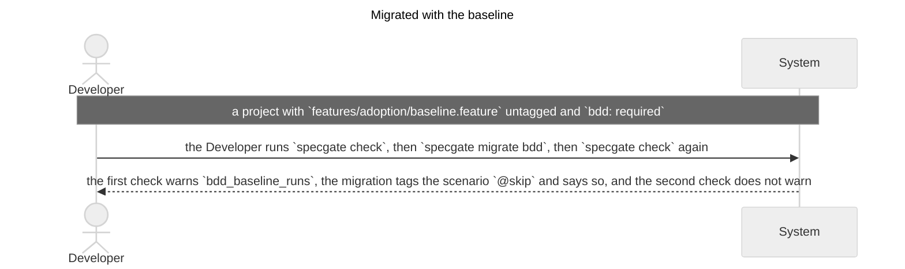

· Drawn from the steps: no endpoint in the code answers them.

New since the base.

### Classes — TypeScript

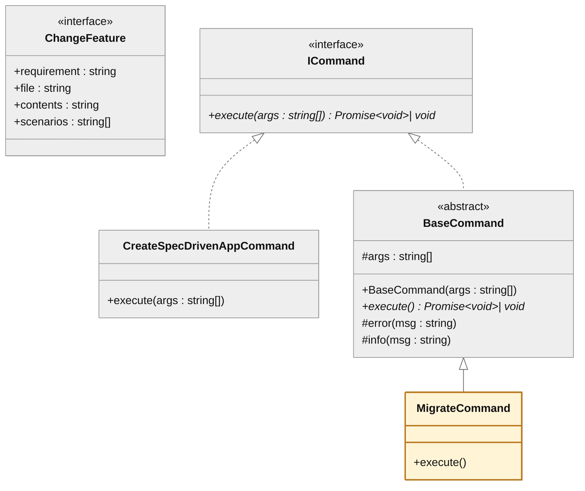

Changed: `MigrateCommand` — `execute()` rewritten.

At the base

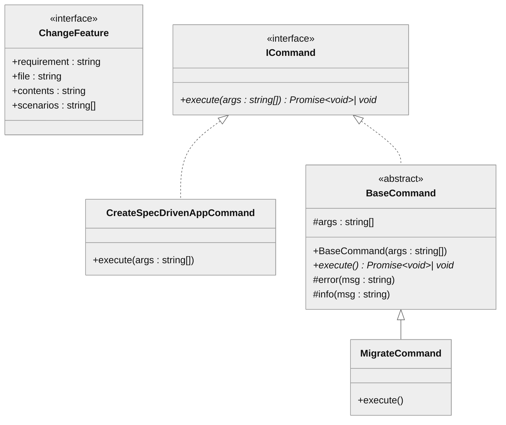

## REQ-823 — apply shows the scenarios as a stage

- No before: `specgate evidence before REQ-823`
- No screenshots: `specgate doctor` says how to have the runner keep them

### Delivered with its scenarios

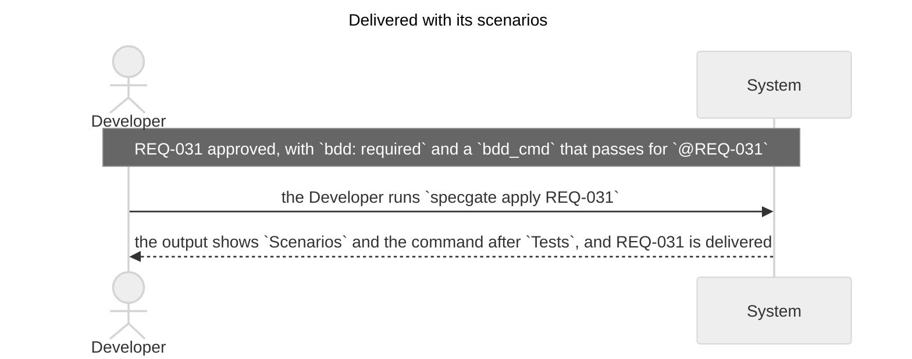

· Drawn from the steps: no endpoint in the code answers them.

New since the base.

## REQ-824 — Each sequence says whether the run agrees

- No before: `specgate evidence before REQ-824`
- No screenshots: `specgate doctor` says how to have the runner keep them

### A refusal the code reading missed

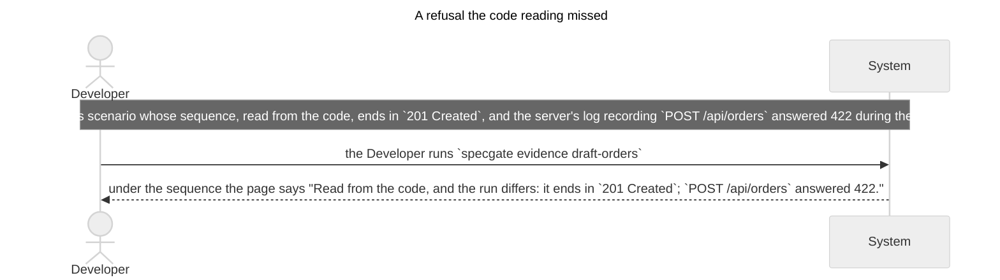

· Drawn from the steps: no endpoint in the code answers them.

New since the base.

### Classes — TypeScript

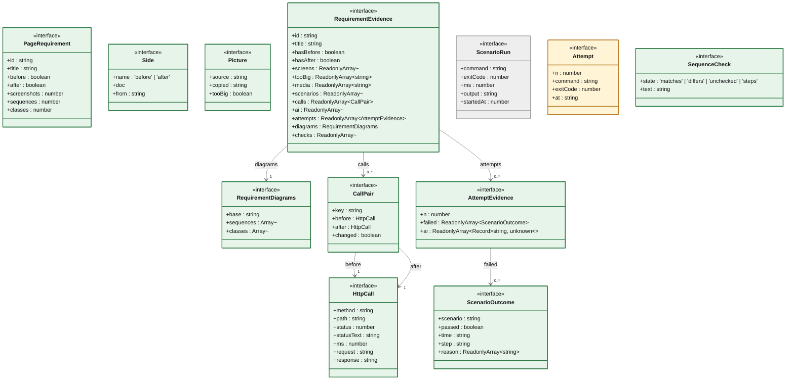

New since the base: `ScenarioOutcome`, `RequirementDiagrams`, `PageRequirement`, `Side`, `Picture`, `CallPair`, `RequirementEvidence`, `AttemptEvidence`, `SequenceCheck`, `HttpCall`. Changed: `Attempt` — added `+n : number`, `+command : string`, `+exitCode : number`, `+at : string` — removed `+road : string`, `+input`.

At the base

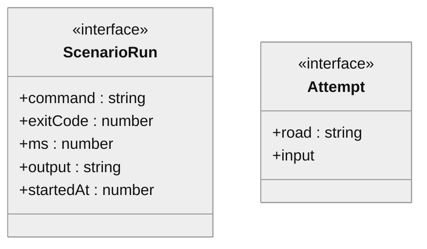

