# The studio

**Studio** is Specgate as an app in your browser: from an empty folder to the
report of what was built, without typing a command. Everything it does runs
the same specgate command you would, so the app and the terminal never
disagree. At the end of this page you can open it on a new folder, write the
brief, have the modules drafted, answer the questions, approve, build, follow
the run live and read the report.

**You need:** Specgate installed (`npm i -g @rsaglobaltech/specgate`), git, and
for drafting and building an agent you can run from the command line (Claude
Code or Codex; see [Choosing and wiring your agent](agent-setup.md)). Docker,
if you want the [quality checks](quality.md).

```bash
cd my-new-project        # an empty folder, or a specgate project
specgate studio          # opens http://127.0.0.1:4173
```

The screenshots come from a small demo shop: one `orders` module with two open
questions, built by a test agent.

## One app, a section per step

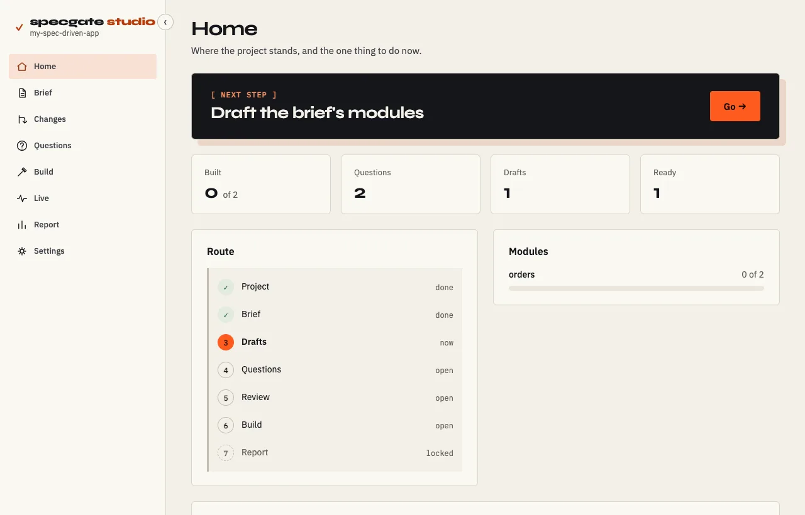

The sidebar holds eight sections, each at its own address (`/#/questions`,
`/#/live`…), so Back, Forward, reloading and a link open the same place.
**Home** says the one thing to do next and where the project stands.

| Section | What you do there | What it runs |
| --- | --- | --- |
| Home | See the next step and the route | `specgate status` |
| Brief | Write what the app must do, or paste the client's text | `propose --from-brief` (with the agent) |
| Changes | Have each module drafted, review it, ask for changes, approve it | `propose --from-brief <module>`, `change note`, `change approve` |
| Questions | Decide what the brief left open, confirm the spec says it | `specgate answer`, `answer --reviewed` |
| Build | Choose who codes, pick what is ready, start | `config set agent`, `harness run --chain` |
| Live | Follow the run, answer the agent, stop it | the harness's events, `harness` stop |
| Report | What was built, how it was proven, what is missing | `specgate report` |
| Settings | Create the project; see its agents and quality checks | `specgate init`, `quality init` |

**Simple** shows no command; **Advanced** adds the brief's markdown editor,
the ids and each agent's command. **ES · EN** switches the language, the
sun and moon the theme (it follows the system until you choose), and **‹**
folds the sidebar to its icons. All of it is remembered in your browser.

## Settings · a project from an empty folder

In an empty folder the studio asks five questions: the name; what you are
building (a website, a service or a mobile app); the technology (Node.js and
React, Java and Spring Boot, Python and FastAPI, or your own); which agent
codes — the one found on this machine is already chosen; and the quality
level. Then it creates the project there, with a brief to fill.

A folder that already holds files is left alone: the studio names the command
that adopts it (`specgate init`), which keeps them. On a project, Settings
lists the agents — the profiles of `.harness/profiles.yaml`, which is the
default and which streams tokens and cost, and a command of your own set in
`harness.config.yaml` — with **Change the assistant**; and the quality checks:
when each runs, whether it gates or advises, and whether Docker answers.

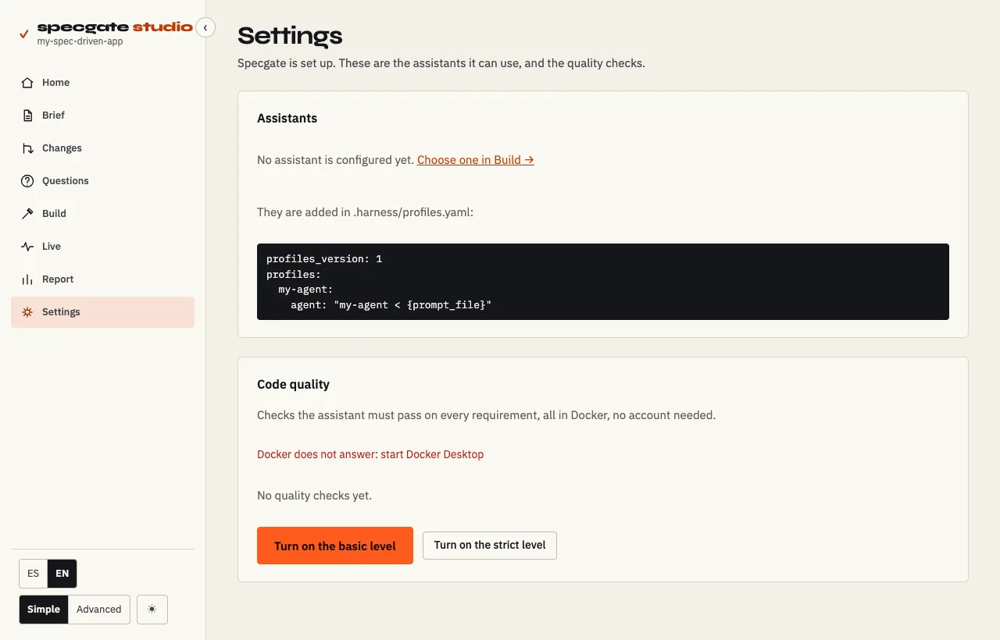

## Brief

The brief is the source of every requirement: what is not in it is not built.
The form — the product in one sentence, who uses it and where, the modules
with their **rules**, **examples** and **open questions** — saves itself into
`docs/brief.md` as you type, keeping every other line of the file. A module
written by hand under `## orders` becomes its `## Module: orders` section, its
text kept in it. Or paste the client's email or notes and let the agent
propose the form. Beside it the brief's checks run on every save, and **Next:
draft the modules** waits while one of them is an error.

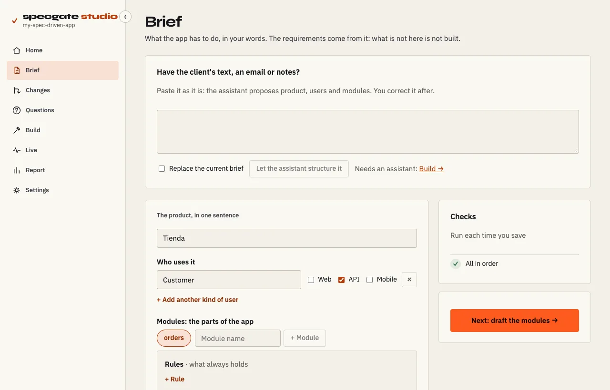

## Changes · draft, review, approve

The brief's modules on the left, each with where it stands — to draft, being
drafted, draft to review, approved, archived. **Draft** hands one to the agent
in the background, one at a time, with its progress as it writes; **Stop**
ends it, with every process the agent started.

A draft to review shows its cycle, then **To approve**: everything that holds
it, each with the action that clears it — **Answer Q1** for an open question,
**The spec says it** for an answer the requirement does not reflect yet, the
file to open for a check that fails. **Approve the draft** says what is still
missing instead of staying grey without a reason. Below, each requirement
with its examples as Given / When / Then, and **Ask for a change** under each.

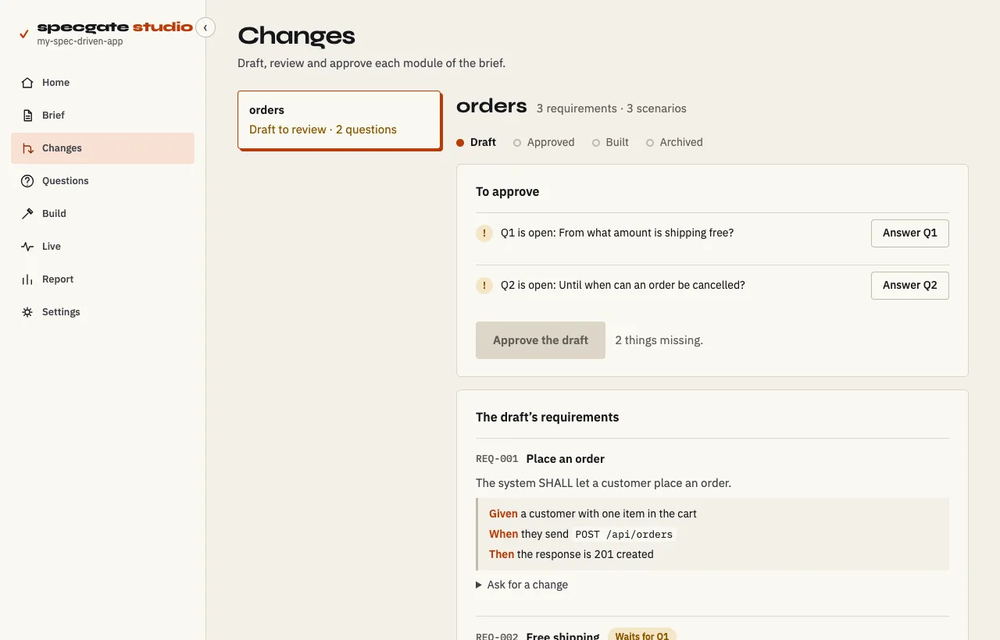

## Questions

Everything waiting for a decision: what the brief asked, what a draft could
not settle, what the agent asked while it built. Pick one of the options
Specgate saw or write your own; **Enter** saves it into the question's row of
`questions.md` — the studio adds the `Answer` and `Status` columns when the
table has none, and keeps the file's line endings.

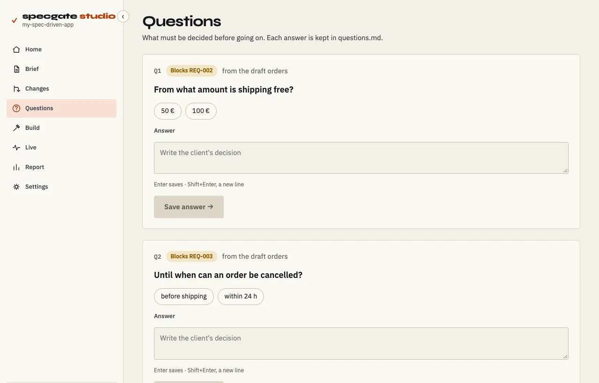

An answered question moves to **Answered · confirm the spec says it**, once,
whether you answered it here or by hand. When the requirement's text says the
answer, **The spec says it** marks it reviewed and lifts `Needs Clarification`
from the requirements it held.

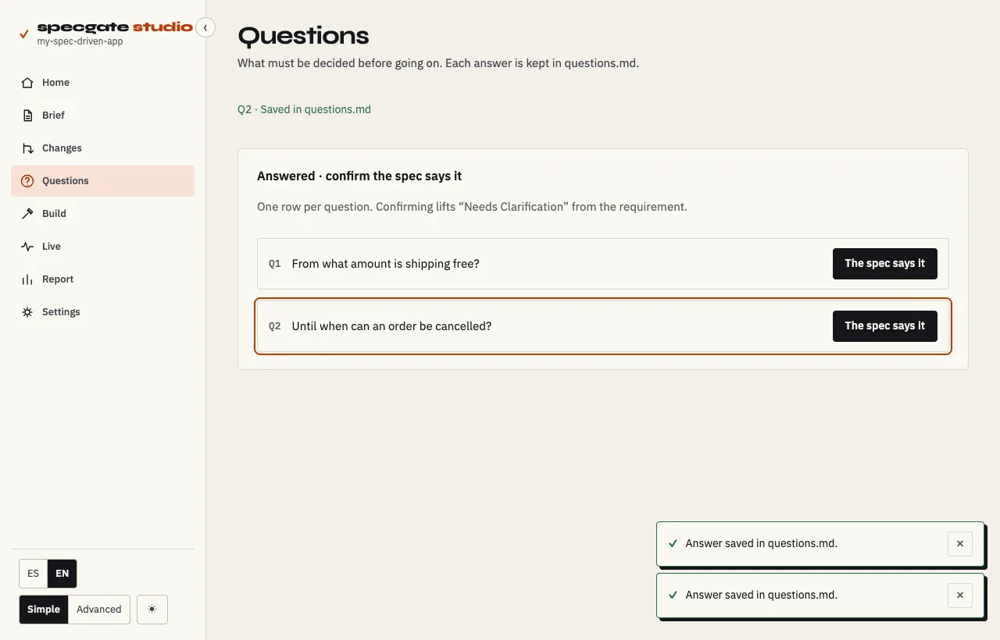

## Build

In a project with no agent yet, Build offers Claude Code, Codex or a command of
your own, the one found on this machine already chosen; **Use this assistant**
writes it to `harness.config.yaml`. Then what is ready to build — approved,
waiting for no answer — each picked, with an estimate, and **Build** starts
the harness in the background. Before it starts, the studio commits the
specification it wrote (the brief, approvals, answers) with your git
identity; any other uncommitted file stops the build, named.

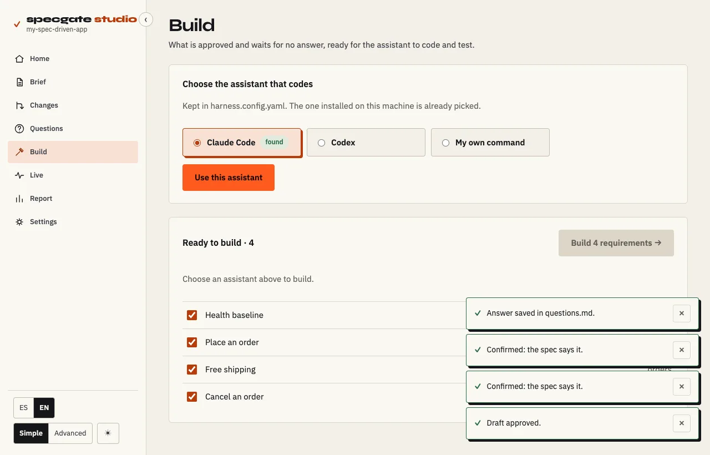

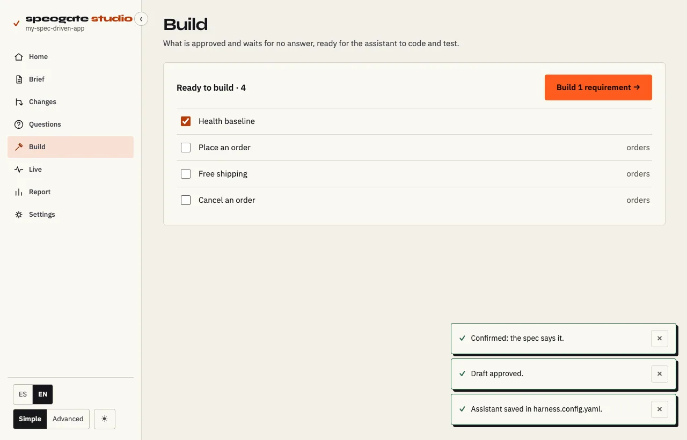

## Live

The run as it happens, pushed by the server: no reload. The header stays in
view with the run's figures — passed, running, failed, the time, the tokens
and the cost — and **Stop after this requirement** or **Stop now**, which asks
first: what the agent has half done is not kept.

- **By module**: a row per module, a square per requirement — passed,
  running, failed, asking, blocked or queued — those the run has not reached
  included. A square opens its requirement.
- **The requirement**, in tabs: **Steps** — the agent, then each gate step by
  its name, the one running with how long it has run, the ones still to
  come — and the agent's log, which follows the end until you scroll up;
  **Requirement**; **Tests and files**; **Attempts**; **Agent** — the model,
  its context against its window, the tokens, and the prompt it was given.
- **The work queue**: **Now**, **Needs attention** — the agent's question,
  answered right there, failures, blocked requirements — **Up next** with an
  estimate, **Open questions**, each with its answer form, and **Finished
  recently**.
- **Traceability**: the matrix as it stands, a fold per module, each scenario
  with its feature, its tests and its status, filtered as you type.

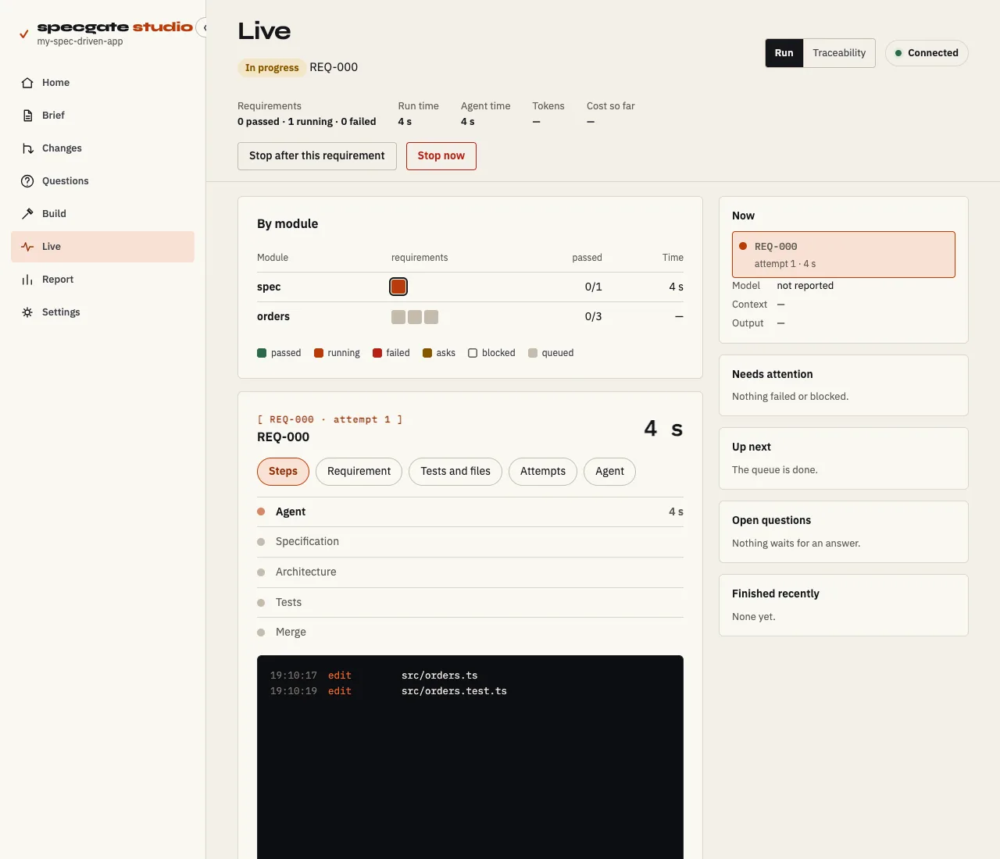

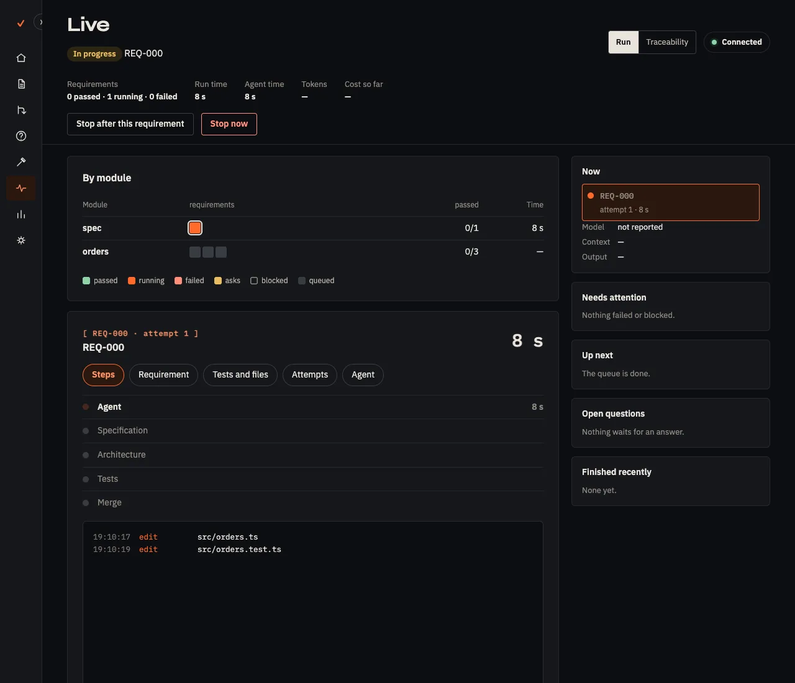

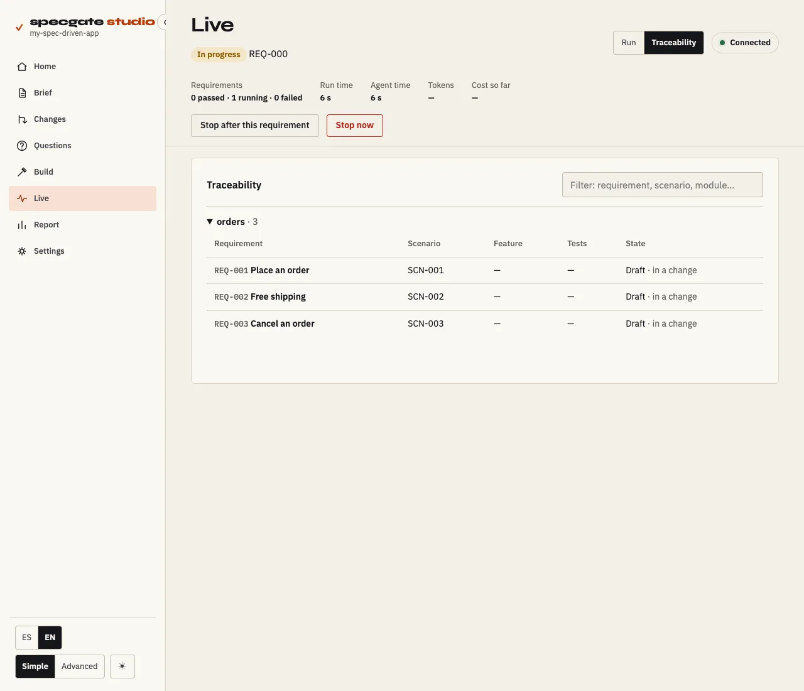

`/live` opens this section directly.

## Report

Built of the total, examples proven, whether the gate passes, the agent's cost
and time and, when the quality checks ran, the code's coverage and mutation
score. Then each module, what the app does already and the example that
proves each requirement, what is missing and why, and the decisions taken.
**Download the report** saves it as one HTML page that opens anywhere;
**Print / PDF** opens it to print.

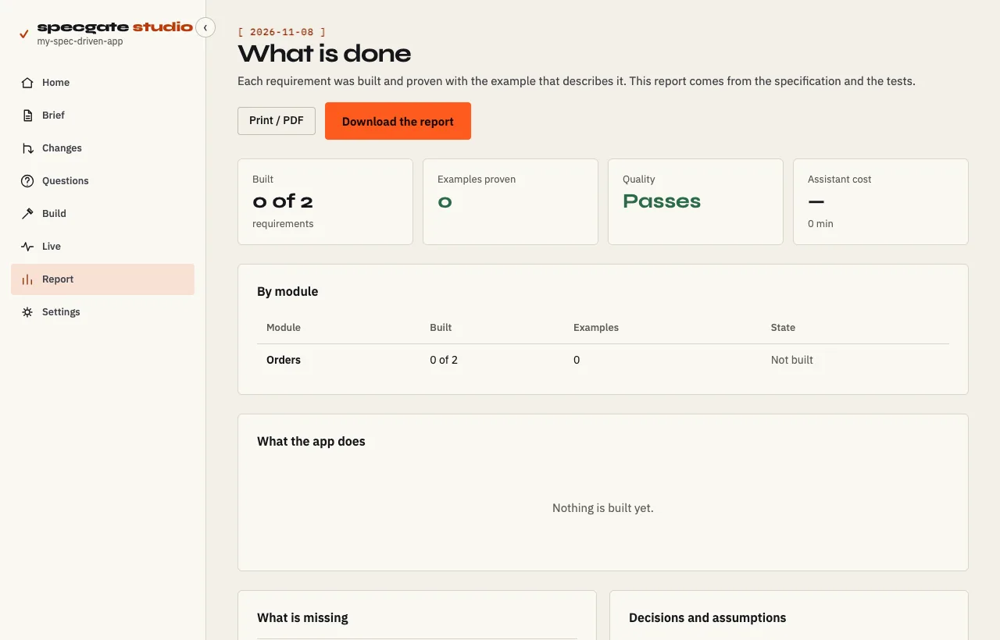

## Saying what it does

- While a section is read for the first time you see its shape, not a blank
  page.
- A button stays busy while its request runs and cannot be pressed twice;
  then a notice says what happened. A success goes by itself; a failure stays
  until you close it, with **Try again**.
- A read that fails says why inside its own section, with **Read it again**;
  the rest of the page keeps working.
- If the studio's server stops answering, the page says it is reconnecting and
  marks what it shows as possibly out of date; when the server answers again
  it says so and reads the section again. A studio started again has a new
  write token, and the page takes it.
- What the checks say comes in your language, with the same ids.

## Keyboard and screen readers

**Skip to the content** is the first thing Tab reaches; the focus is always
visible; a section you open takes the focus to its title; an answered question
keeps the focus on its row; each result is announced once, by its notice. The
requirement's tabs move with the arrow keys. With reduced motion asked by the
system, nothing moves.

## Speed

The studio reads the project's state in its own process and keeps it until a
file of the specification changes, so a refresh costs milliseconds, also on
Windows.

## Safety

Studio answers on `127.0.0.1` only, and refuses another host name. Every
action that writes is a `POST` with a JSON body, the token the page receives
when studio starts, and a loopback origin; any other method is refused. The
app loads nothing from another host, and nothing a project or an event holds
is ever read as HTML.

## Next

- [Quality and security checks](quality.md) — what the quality level turns on.
- [The harness](harness.md) — what Build runs, in the terminal.
- [From a client brief to a spec](from-a-brief.md) — the brief and the drafts,
  in the terminal.
