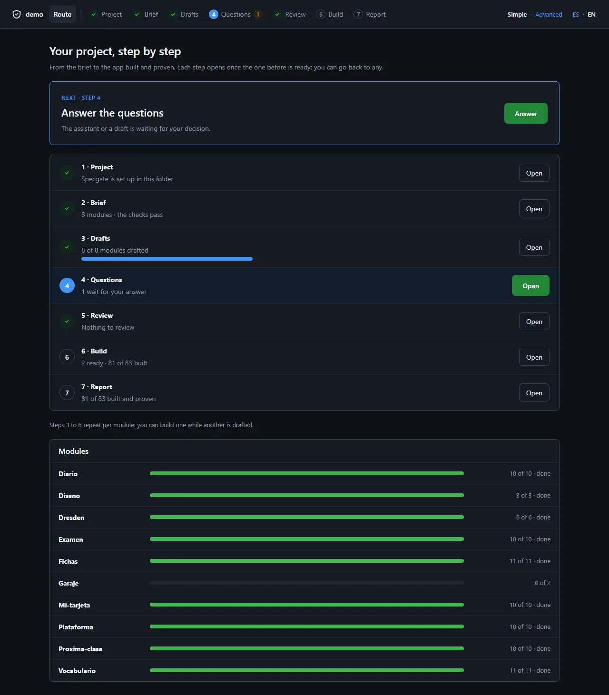
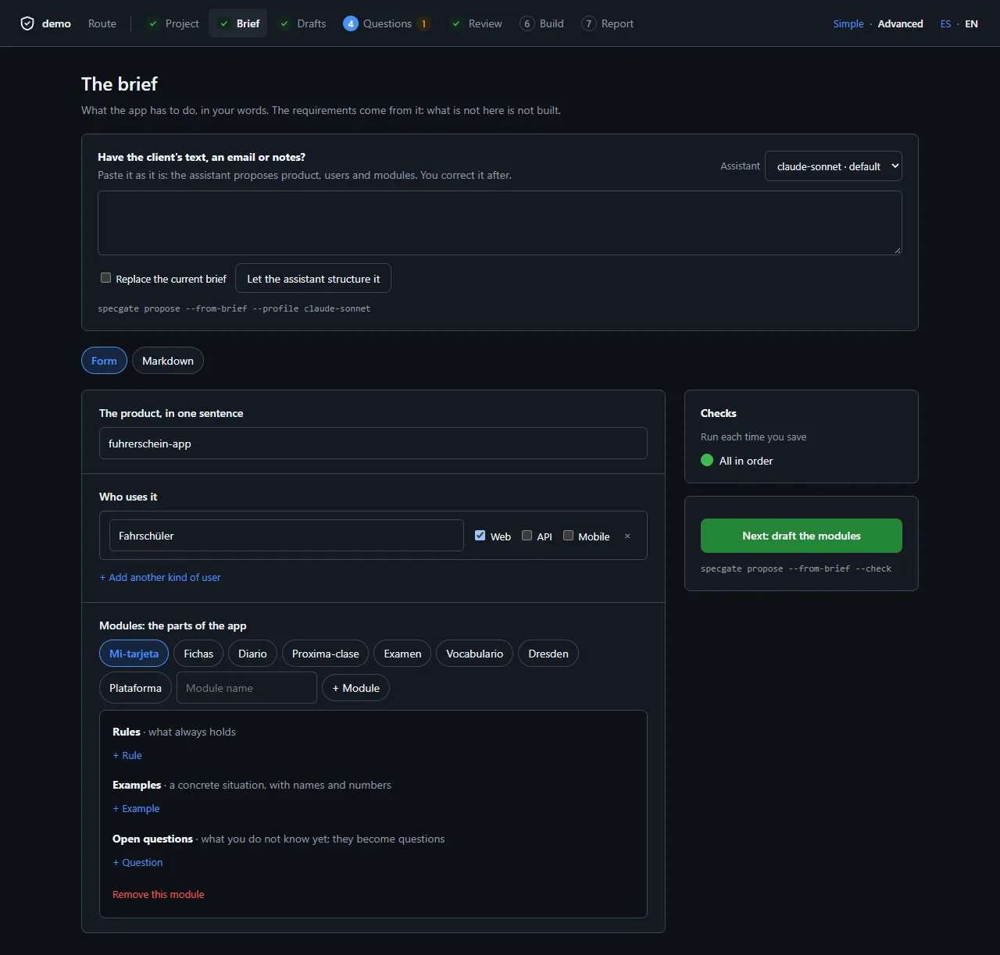
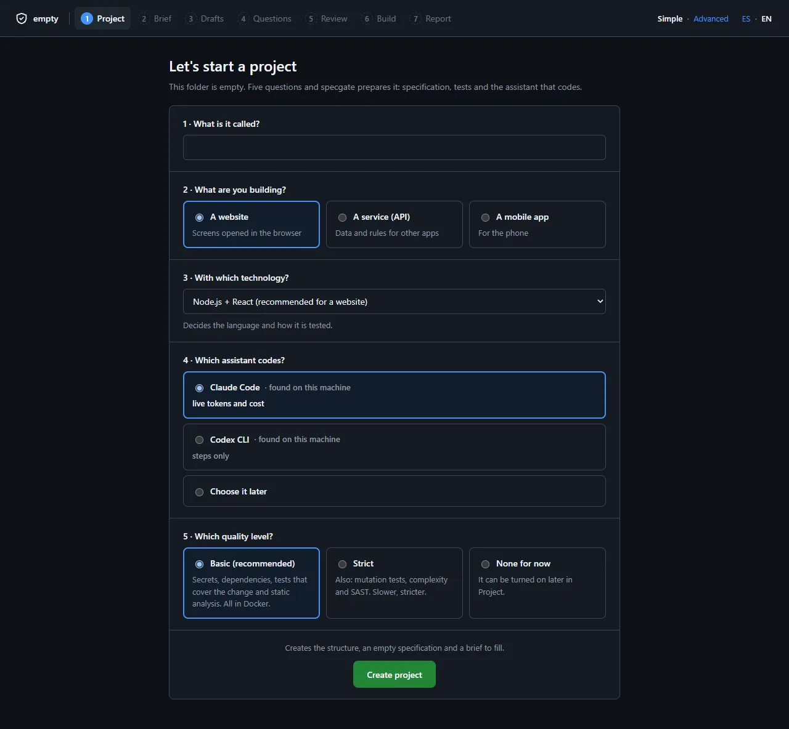
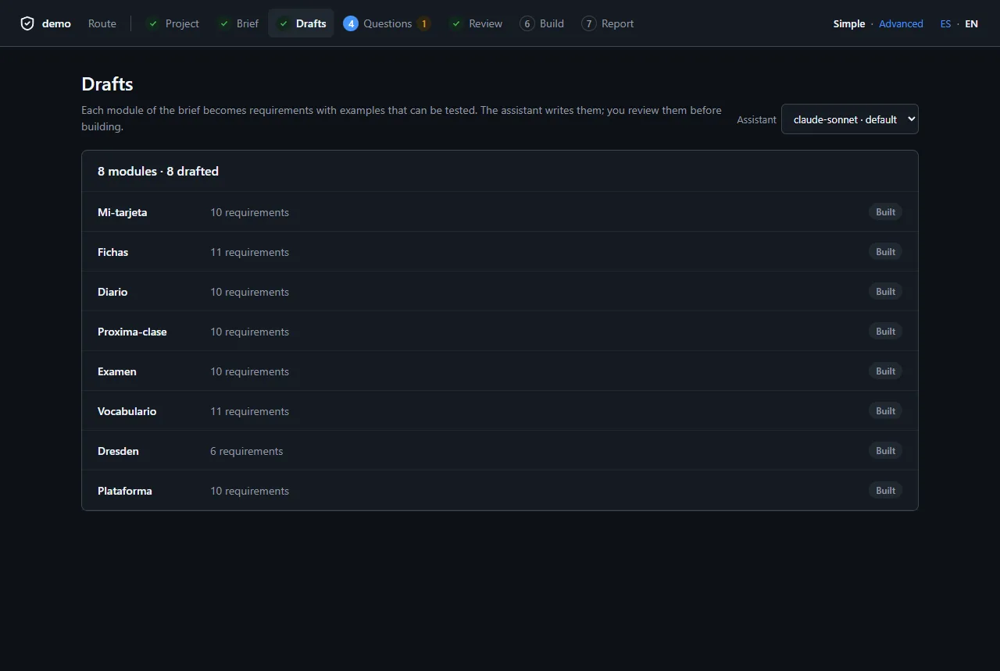
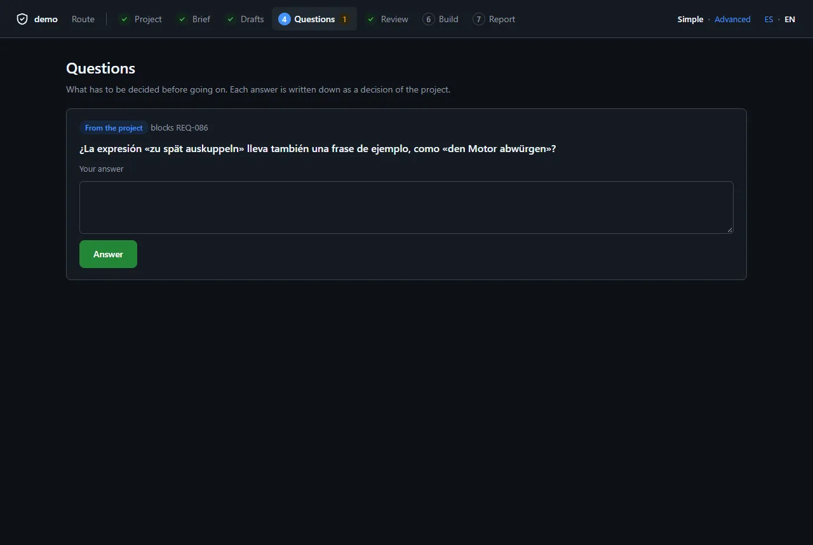
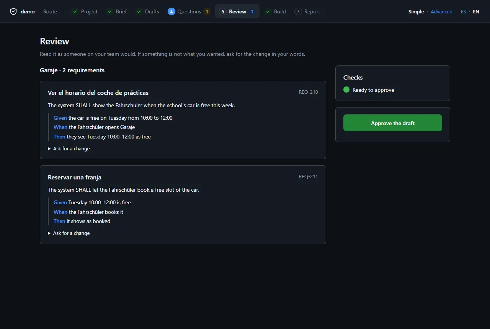
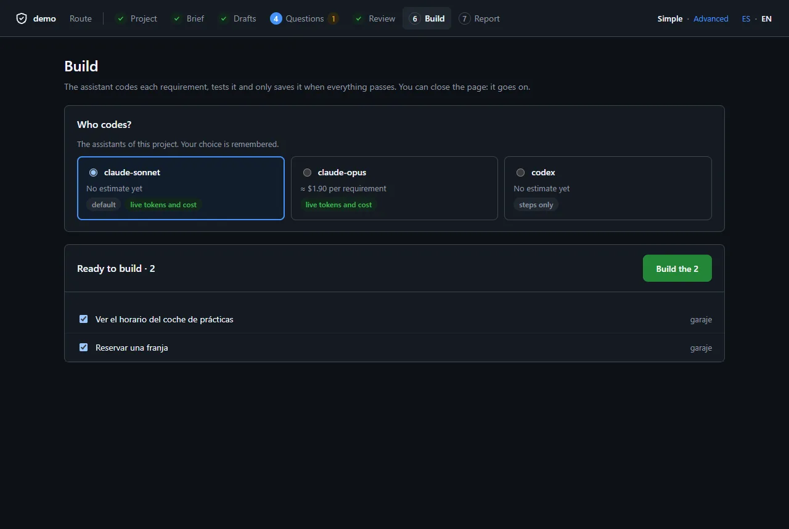
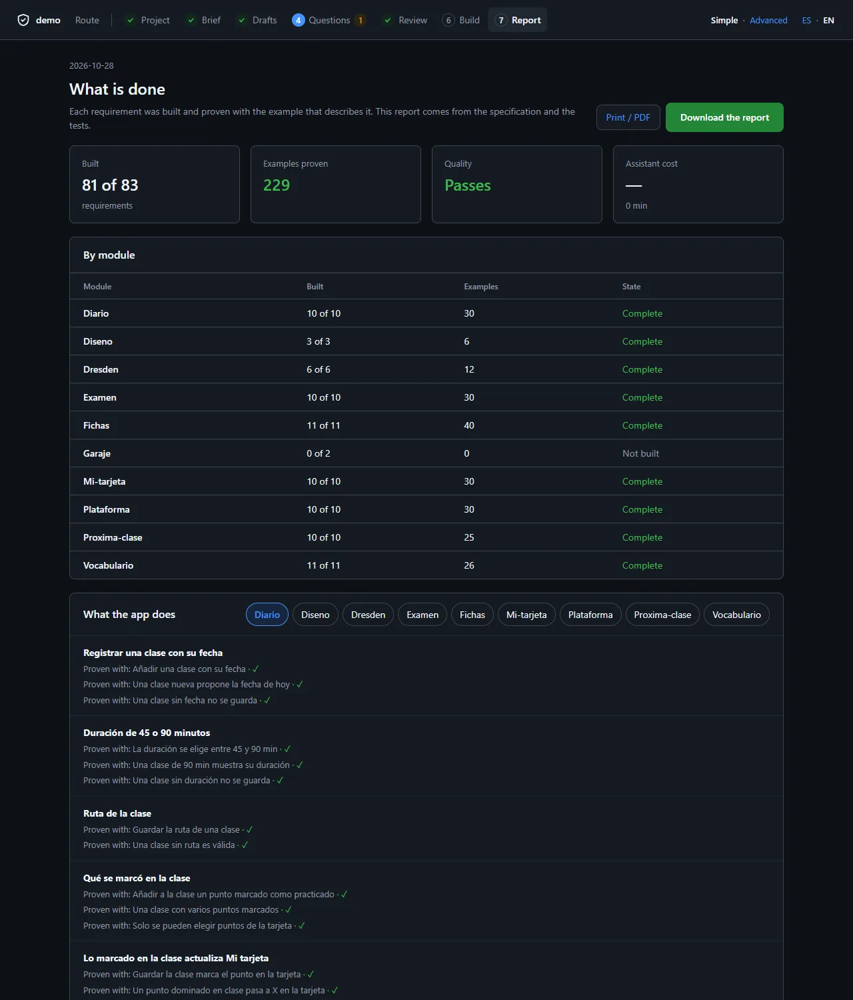

# The studio

**Studio** is Specgate as an app in your browser: from an empty folder to the
report of what was built, step by step, without typing a command. Everything
it does runs the same specgate command you would, so the app and the terminal
never disagree. At the end of this page you can open it on a new folder, write
the brief, have the modules drafted, answer the questions, approve, build and
read the report.

**You need:** Specgate installed (`npm i -g @rsaglobaltech/specgate`), git, and
for drafting and building an agent you can run from the command line (Claude
Code or Codex; see [Choosing and wiring your agent](agent-setup.md)). Docker,
if you want the [quality checks](quality.md).

```bash
cd my-new-project        # an empty folder, or a specgate project
specgate studio          # opens http://127.0.0.1:4173
```

## The route

The screenshots come from a copy of the driving-school pilot: the interface in English, the requirements in Spanish.



Across the top are seven steps. Each is **done** (a tick), **current** (blue),
**open** or **locked**, read from the project's files every few seconds; the
Route page says the one thing to do next.

| Step | What you do there | What it runs |
| --- | --- | --- |
| 1 · Project | Create it, or see its agents and quality checks | `specgate init`, `harness init`, `quality init` |
| 2 · Brief | Write what the app must do, or paste the client's text | `propose --from-brief` (with the agent) |
| 3 · Drafts | Have each module turned into requirements with examples | `propose --from-brief <module>` |
| 4 · Questions | Decide what the brief left open | `specgate answer` |
| 5 · Review | Read each draft, ask for changes, approve it | `change note`, `change approve` |
| 6 · Build | Pick who codes and what, start, follow, stop | `harness run --chain --profile` |
| 7 · Report | What was built, how it was proven, what is missing | — |

Steps 3 to 6 repeat per module: you can build one module while another is
being drafted.

## Simple and advanced, Spanish and English

**Simple** shows no command. **Advanced** shows, under each action, the
command it runs and the file it writes, and adds the brief's markdown editor
(below: the Brief page in advanced mode, `specgate propose --from-brief` under
its buttons).
**ES · EN** switches the language. All three choices are remembered in your
browser.



## 1 · A project from an empty folder

In an empty folder the studio asks five questions: the name; what you are
building (a website, a service or a mobile app); the technology (Node.js and
React, Java and Spring Boot, Python and FastAPI, or your own); which agent
codes (it says which it found on this machine); and the quality level (basic,
strict or none). Then it creates the project there, writes the agent's
profiles and the quality checks, a brief to fill, and a first commit.



A folder that already holds files is left alone: the studio names the command
that adopts it (`specgate init`), which keeps them.

On an existing project, Project lists the agents (`.harness/profiles.yaml`) —
which is the default, whether it streams tokens and cost to the live view —
and the quality checks: when each runs, whether it gates or advises, how it
runs on this machine, and whether Docker answers.


## 2 · The brief

The brief is the source of every requirement: what is not in it is not built.

- **The form** (simple mode): the product in one sentence, who uses it and
  where (web, API, mobile), and the modules — each with its **rules** (what
  always holds), **examples** (a concrete case, with names and numbers) and
  **open questions**. It saves as you type into `docs/brief.md`, keeping every
  other line of the file.
- **Markdown** (advanced mode): the file itself.
- **Paste the client's text**: an email, notes, a document. The agent proposes
  the product, the users and the modules from it; you correct the form after.


Beside it, the brief's checks (B1–B13) run on every save. **Next: draft the
modules** stays disabled while one of them is an error.

## 3 · Drafts

Each module of the brief, with where it stands: not drafted, being drafted,
to review, approved, built. **Draft** hands the module to the agent you pick,
in the background, one module at a time; its progress shows what the draft
holds so far — requirements written, examples written, questions and
assumptions noted — and the agent's last step when it streams. **Stop** ends
it. A draft ready to review lists its checks (D1–D13) in plain words.



## 4 · Questions

Everything waiting for a decision: what the brief asked, what a draft could
not settle, what the agent asked instead of guessing while it built. Pick one
of the options Specgate saw or write your own answer. Once the specification
says it, **The spec says it** confirms it, and the requirements the question
held can be built.



## 5 · Review

Each draft not yet approved, as someone on your team would read it: each
requirement's statement and its examples as Given / When / Then. **Ask for a
change** writes your words into the draft's `review.md` for the agent; **Approve
the draft** records that a person approved it, and is disabled while a check
fails or a question is open.



## 6 · Build

**Who codes?** lists the agents, each with its estimated cost per requirement
and whether it streams tokens and cost; your choice is remembered. Then the
requirements ready to build — approved, not waiting for an answer — with an
estimate, and **Build** starts the harness in the background, chained.

Before it starts, the studio commits the specification it wrote (the brief,
approvals, answers) with your git identity, because the harness needs a clean
tree. Any other uncommitted file stops the build, named; it is never committed
for you.

While it runs, the page shows the requirement in progress in four plain steps
— codes, tests, checks quality, saves — and what the agent last said. **Stop
after this one** finishes the current requirement and stops. **Watch live**
opens `/live`, the detailed view.



## 7 · The report

Built of the total, examples proven, whether the gate passes, the agent's cost
and time and, when the quality checks ran, the code's diff coverage and
mutation score. Then each module, and for each built requirement the example
that proves it and its quality figures; what is missing and why (not built, or
waiting for an answer, with the question); and the decisions taken. **Download
the report** saves it as one HTML page that opens anywhere; **Print / PDF**
opens it to print.



## Safety

Studio answers on `127.0.0.1` only, and refuses another host name. Every
action that writes is a `POST` with a JSON body, a token the page receives
when studio starts, and a loopback origin; any other method is refused. The
app's reads are under `/api/*`; the overview it replaced is at `/overview`,
the live view at `/live`.

## Next

- [Quality and security checks](quality.md) — what the quality level turns on.
- [The harness](harness.md) — what Build runs, in the terminal.
- [From a client brief to a spec](from-a-brief.md) — the brief and the drafts,
  in the terminal.
